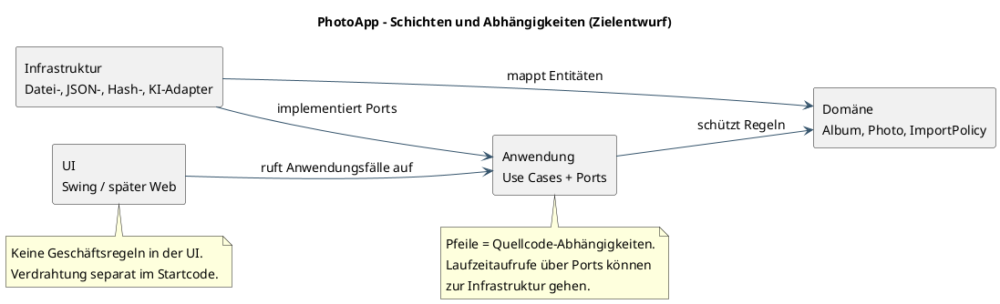

# Architektur und Entwurf – Block 3
Status: Entwurf für Teamreview · Grundlage: hochgeladene Anforderungen und Projektbeschreibung §8.
Die Diagramme beschreiben den Zielentwurf; der Java-Code ist erst das Block-3-Gerüst.

## 1. Rahmen und Schichten
Verbindlich aus euren Angaben: **10.000 Fotos pro Album**, 50 MB je Datei, Albumname 1–50
Zeichen und nicht nur Leerzeichen, SHA-256-Duplikatprüfung innerhalb eines Albums.
Formate sowie maximale Titel-/Beschreibungslänge sind offen; keine erfundenen Grenzwerte.

`ui → application → domain`; `infrastructure → application/domain`.
Die Domäne kennt weder Swing noch Dateipfade oder JSON. Anwendungsfälle koordinieren Ports;
Adapter führen technische Ein-/Ausgaben aus. Dadurch bleiben Regeln für weitere Oberflächen
wiederverwendbar und ohne Dateisystem testbar. Die Startverdrahtung gehört in einen späteren
Composition Root außerhalb der fachlichen UI. Siehe [ADR-001](docs/adr/ADR-001-ports.md).

## 2. Komponenten und Regeln
| Komponente | Verantwortung |
|---|---|
| Album, Photo | Albumname, Kapazität, albumlokale Hash-Eindeutigkeit; Fotoidentität und Metadaten |
| AddPhotoUseCase | Import: Snapshot, Validieren, Hash, Regelprüfung, Kopieren, Metadaten speichern |
| DeleteAlbumUseCase | Vorschau, Bestätigung, zuerst Löschstatus speichern, dann Papierkorb |
| AlbumRepository | `findById`, `findAll`, `save`; `AlbumSummary` für Übersicht, keine Bilddaten |
| PhotoStorage | unveränderlicher Import-Snapshot, Ablage, seitenweise Vorschaubilder, sicherer Papierkorb |
| ImageFileValidator | **Port** für technische Dateiprüfung; FileImageFileValidator liest Dateien |
| ImageHasher | SHA-256 des validierten Snapshots; Adapter Sha256ImageHasher |
| PhotoController | UI-Aufrufe und Darstellung, kurze Fehlermeldungen; keine Geschäftsregeln |

Album prüft die 10.000-Grenze und Hash-Eindeutigkeit selbst in `checkCanAdd`/`addPhoto`.
Album prüft den Namen in Konstruktor/`rename`. Photo verwaltet Titel/Beschreibung über
`editMetadata`; ungeklärte Längengrenzen werden nach Auftraggeberentscheidung dort ergänzt.
50 MB und erlaubte Formate sind eine fachliche ImportPolicy; der Validator setzt diese
anhand tatsächlicher Dateiinhalte um. Erlaubte Formate werden vor dem produktiven Import
festgelegt. Dateiendungen allein reichen nicht. [CRC-Karten](docs/design/CRC.md)
und [Schnittstellen](docs/design/SCHNITTSTELLEN.md) konkretisieren die Verantwortlichkeiten.

## 3. Abläufe und Fehler
[Foto hinzufügen](docs/design/foto-hinzufuegen.png): `stage` erzeugt eine unveränderliche,
begrenzt große Kopie; Validierung, Hash und Import verwenden dieselben Bytes. Bei Duplikat,
Limit oder Validierungsfehler bleibt das Album unverändert. Erst Bild ablegen, dann JSON
atomar speichern; scheitert das Speichern, wird die neue Datei bereinigt. Ein fehlgeschlagenes
Bereinigen hinterlässt nur eine verwaiste Datei für die Startbereinigung.
Mehrfachimport ruft diesen Ablauf einzeln auf; bereits erfolgreiche Fotos bleiben erhalten,
überzählige werden abgewiesen und zusammengefasst gemeldet. Ein einzelner Schreibprozess
serialisiert Änderungen je Album einschließlich Hash-/Limitprüfung.

[Album löschen](docs/design/album-loeschen.png): Vorschau enthält Fotoanzahl und Version;
Bestätigung gilt nur für diese Version. Zuerst `deletedAt` speichern, dann `moveToTrash`.
Dieser Port kopiert zunächst vollständig und prüft die Kopien, bevor aktive Dateien entfernt
werden. Scheitert er vor dem Commit, bleiben Originale vollständig und der Status wird
zurückgesetzt. Scheitert auch das Zurücksetzen, bleibt das Album als gelöscht markiert;
Recovery erhält die Dateien. Kein Erfolg wird vorgetäuscht. Abbruch verändert nichts.
Details zu Absturz, Teilfehler und endgültigem Löschen: [ADR-003](docs/adr/ADR-003-fehler.md).
Speicherformat und Pfade: [ADR-002](docs/adr/ADR-002-json.md).

## 4. Große Alben und Plattformen
Metadaten enthalten Hashes und Referenzen, keine Bildbytes. `PhotoStorage.loadPage` lädt
höchstens 100 kleine Vorschauen; UI hält einen begrenzten Vorschaupuffer statt 10.000 Originalen.
Echte Leistungsmessung folgt in Block 5; eine maximale Ladezeit ist nicht vereinbart.
Sortieren (Datum, alphabetisch, manuell) bleibt bei Album; Seiten werden in dieser Reihenfolge
abgerufen. Swing ist die vorhandene Geräte-UI. Web-App und gemeinsames Teilen sind durch
NFA-04/FA-09 gefordert, aber durch lokale Dateispeicherung und Swing noch nicht erfüllt:
Backend, Identitäten und Freigaben bleiben offen, nicht stillschweigend gestrichen.

## 5. Optionale KI-Komponente – Won’t implement
`DescriptionSuggester` (Anwendungsport) und `LlmDescriptionSuggester` (Infrastrukturadapter)
sind entworfen, nicht aktiviert. Vor Anfrage: explizite Zustimmung, erlaubtes Bild und
EXIF-/Personendaten-Minimierung; danach: Länge, Inhalt und untrusted Text prüfen.
Ausgabe bleibt ein Vorschlag; Speichern erfordert menschliche Übernahme.
Der Agent „Fotos aufräumen“ hat maximal vier Tools mit Freigabeprüfung im Code,
nicht nur im Prompt: [KI-Entwurf/Tool-Liste](docs/design/KI.md), [ADR-004](docs/adr/ADR-004-ki.md).

## 6. Stand und offene Entscheidungen
Java 21, Maven Wrapper, JUnit 5 und Swing bleiben erhalten. Ports/Use Cases sind Zielentwurf;
keine fertige Fotoverwaltung behauptet. Formatliste, Titel-/Beschreibungslängen, Definition
von MB (dezimal/binär), Sortierdatum, Aufbewahrungsdauer/Wiederherstellen und Web/Sharing
müssen geklärt werden. Die Angabe 10.000 ist vom Team bestätigt und bleibt unverändert.
Review und Merge/Tag sind erst nach echtem Teamreview abzuschließen; [Abgabestatus](docs/BLOCK3_STATUS.md).

[PDF-Lesefassung](docs/Block3_Lesefassung.pdf) · [Prüfprotokoll](docs/PRUEFPROTOKOLL.md)
