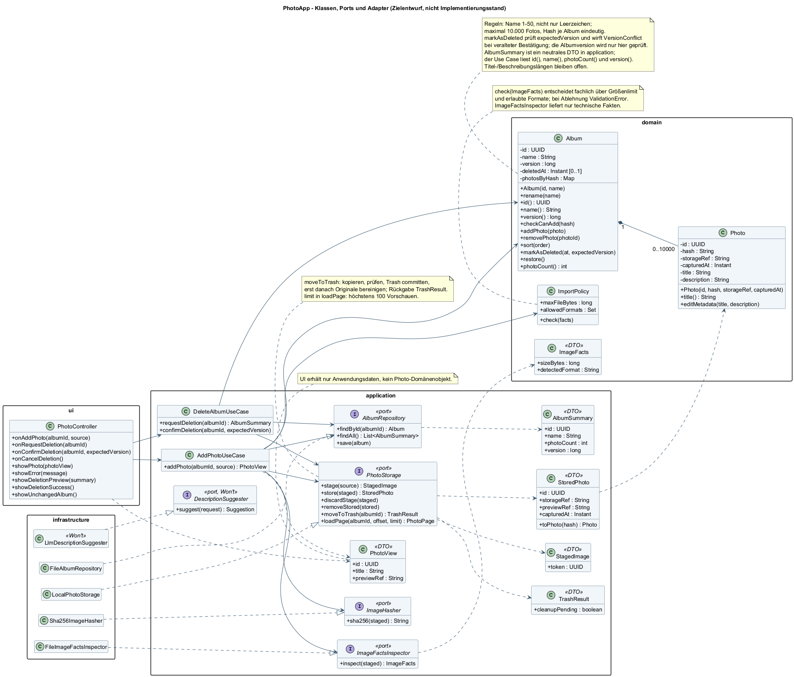

# Architektur und Entwurf – Block 3
Status: Entwurf für Teamreview · Grundlage: [Anforderungen](REQUIREMENTS.md) und Projektbeschreibung §8.
Die Diagramme beschreiben den Zielentwurf; der Java-Code ist erst das Block-3-Gerüst.

## 1. Rahmen und Schichten
Verbindlich aus euren Angaben: **10.000 Fotos pro Album**, 50 MB je Datei, Albumname 1–50
Zeichen und nicht nur Leerzeichen, SHA-256-Duplikatprüfung innerhalb eines Albums.
JPG, JPEG, PNG und SVG sind als Teamannahme festgehalten (A-09). Textgrenzen stehen in GR-04 und GR-05.

`ui → application → domain`; `infrastructure → application/domain`.
Die Domäne kennt weder Swing noch Dateipfade oder JSON. Anwendungsfälle koordinieren Ports;
Adapter führen technische Ein-/Ausgaben aus. Dadurch bleiben Regeln für weitere Oberflächen
wiederverwendbar und ohne Dateisystem testbar. Die Startverdrahtung gehört in einen späteren
Composition Root außerhalb der fachlichen UI. Siehe [ADR-001](docs/adr/ADR-001-ports.md).

## 2. Komponenten und Regeln
| Komponente | Verantwortung |
|---|---|
| Album, Photo | Albumname, Kapazität, albumlokale Hash-Eindeutigkeit; Fotoidentität und Metadaten |
| AddPhotoUseCase | Import: Snapshot, Validieren, Hash, Regelprüfung, Kopieren, Metadaten speichern |
| DeleteAlbumUseCase | Vorschau, Bestätigung, zuerst Löschstatus speichern, dann Papierkorb |
| AlbumRepository | `findById`, `findAll`, `save`; `AlbumSummary` für Übersicht, keine Bilddaten |
| PhotoStorage | unveränderlicher Import-Snapshot, Ablage, seitenweise Vorschaubilder, sicherer Papierkorb |
| ImageFactsInspector | **Port** für technische Fakten aus einem Snapshot; FileImageFactsInspector ermittelt Größe und erkanntes Format |
| ImageHasher | SHA-256 des validierten Snapshots; Adapter Sha256ImageHasher |
| PhotoController | UI-Aufrufe und Darstellung, kurze Fehlermeldungen; keine Geschäftsregeln |

Album prüft die 10.000-Grenze und Hash-Eindeutigkeit selbst in `checkCanAdd`/`addPhoto`.
Album prüft den Namen im Konstruktor und in `rename`. Die geplante Metadatenbearbeitung
berücksichtigt die Textgrenzen aus GR-05. `ImageFactsInspector` meldet technische Fakten
(Größe und erkanntes Format); `ImportPolicy.check(facts)` entscheidet als Domänenregel über
Größenlimit und erlaubte Formate und meldet eine Ablehnung als `ValidationError`.
[CRC-Karten](docs/design/CRC.md)
und [Schnittstellen](docs/design/SCHNITTSTELLEN.md) konkretisieren die Verantwortlichkeiten.

## 3. Abläufe und Fehler
[Foto hinzufügen](docs/design/foto-hinzufuegen.png): `stage` erzeugt eine unveränderliche,
begrenzt große Kopie; Validierung, Hash und Import verwenden dieselben Bytes. Bei Duplikat,
Limit oder Validierungsfehler bleibt das Album unverändert. Erst Bild ablegen, dann JSON
atomar speichern; scheitert das Speichern, wird die neue Datei bereinigt. Ein fehlgeschlagenes
Bereinigen hinterlässt nur eine verwaiste Datei für die Startbereinigung.
Mehrfachimport ruft diesen Ablauf einzeln auf; bereits erfolgreiche Fotos bleiben erhalten,
überzählige werden abgewiesen und zusammengefasst gemeldet. Ein einzelner Schreibprozess
serialisiert Änderungen je Album einschließlich Hash-/Limitprüfung.

[Album löschen](docs/design/album-loeschen.png): Vorschau enthält Fotoanzahl und Version;
`Album.markAsDeleted(at, expectedVersion)` ist alleiniger Besitzer der fachlichen
Versionsprüfung und wirft bei veralteter Bestätigung `VersionConflict`, ohne den Zustand zu
ändern. Bei Erfolg steigt die Version; dann wird `deletedAt` gespeichert und `moveToTrash`
aufgerufen. Der Adapter liefert `TrashResult(cleanupPending)` nach erfolgreichem Commit.
Dieser Port kopiert zunächst vollständig und prüft die Kopien, bevor aktive Dateien entfernt
werden. Scheitert er vor dem Commit, bleiben Originale vollständig und der Status wird
zurückgesetzt. Scheitert auch das Zurücksetzen, bleibt das Album als gelöscht markiert;
Recovery erhält die Dateien. Kein Erfolg wird vorgetäuscht. Abbruch verändert nichts.
Details zu Absturz, Teilfehler und endgültigem Löschen: [ADR-003](docs/adr/ADR-003-fehler.md).
Speicherformat und Pfade: [ADR-002](docs/adr/ADR-002-json.md).

## 4. Große Alben und Plattformen
Metadaten enthalten Hashes und Referenzen. Beim Öffnen eines Cores werden bis zu 100
Vorschauen vorgeladen, danach folgen Blöcke zu 50 in der jeweiligen Sortierreihenfolge
(GR-11, A-05). Die UI hält dafür einen begrenzten Vorschaupuffer. NFA-01 verlangt die
Anzeige der ersten 100 bereits gespeicherten Vorschaubilder binnen zwei Sekunden unter den
Bedingungen aus A-06. Die Messung steht aus.

Der Prüfungsumfang umfasst die lokale Desktop-Anwendung für Windows, macOS und Linux.
Web, Cloud, Mobile und gemeinsames Teilen liegen im Vision-Backlog.

## 5. Optionale KI-Komponente – Won’t implement
`DescriptionSuggester` (Anwendungsport) und `LlmDescriptionSuggester` (Infrastrukturadapter)
sind entworfen, nicht aktiviert. Vor Anfrage: explizite Zustimmung, erlaubtes Bild und
EXIF-/Personendaten-Minimierung; danach: Länge, Inhalt und untrusted Text prüfen.
Ausgabe bleibt ein Vorschlag; Speichern erfordert menschliche Übernahme.
Der Agent „Fotos aufräumen“ hat maximal vier Tools mit Freigabeprüfung im Code,
nicht nur im Prompt: [KI-Entwurf/Tool-Liste](docs/design/KI.md), [ADR-004](docs/adr/ADR-004-ki.md).

## 6. Stand und offene Entscheidungen
Implementiert sind die Swing-Platzhalteroberfläche sowie `Album` und `Photo` mit ersten
Domänenregeln. Use Cases, Ports und Dateisystemadapter sind Zielentwurf. Die noch zu
bestätigenden Annahmen und offenen Entwurfsfragen stehen unter
[Offene Entscheidungen](docs/design/OFFENE_ENTSCHEIDUNGEN.md). Das Teamreview steht aus.
