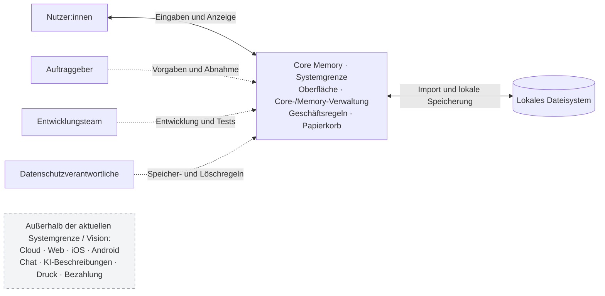
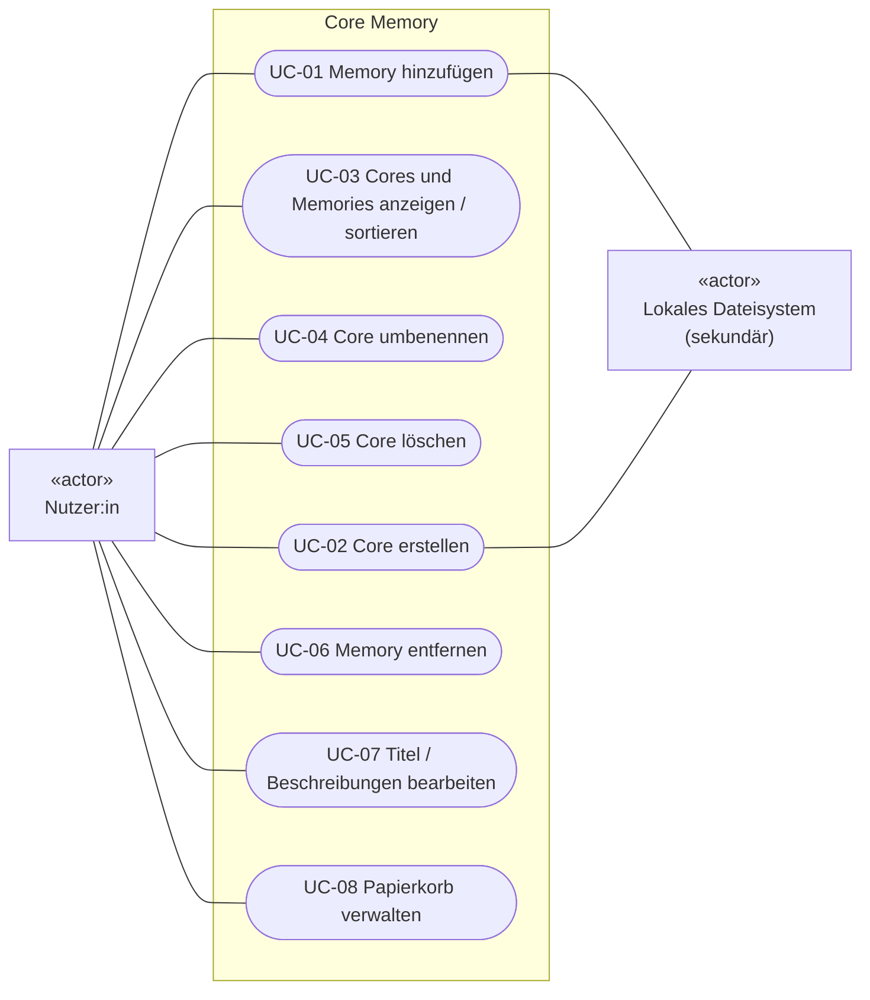

# Core Memory – REQUIREMENTS v1 (Reviewstand)

**Core = Album · Memory = Foto.** Stand: Block 2 nach Review. Dieses Dokument beschreibt das Soll-Verhalten; der HTML-Prototyp ist kein Umsetzungsnachweis.

## 1. Grundlage und Umfang

**Verbindliche fachliche Grundlage:** Das Interview der Auftraggebergruppe aus Block 2, Folie 31, dokumentiert im separat bereitgestellten Interviewprotokoll `Interview_merged.pdf`. Das Original ist derzeit nicht Bestandteil dieses Repositories; vor einer Veröffentlichung ist zu klären, ob es mit aufgenommen werden darf. Bei Abweichungen ersetzt es die frühere Ideensammlung. Spätere ausdrückliche Teamentscheidungen ergänzen oder ändern das Interview. Ungeklärte Aussagen werden nicht als bestätigte Grenzwerte behandelt.

**Auftraggeber-Entscheidungen:** Die Chat-Funktion entfällt. Für den Prüfungsumfang werden Daten ausschließlich lokal gespeichert. Die Anforderungen umfassen lokale Kernfunktionen für Java 21 unter Windows, macOS und Linux; die Oberfläche darf JavaFX, Swing oder Konsole verwenden. Cloud-Synchronisierung, Web-, iOS- und Android-Zugriff liegen außerhalb der Systemgrenze und sind Vision. Zusätzliche Technologien benötigen einen ADR und müssen in CI ohne manuelle Installation gebaut und getestet werden. Weitere Entscheidungen sind in Abschnitt „Auftraggeber-Entscheidungen“ aufgeführt.

**Prüfungsrahmen:** Java 21, Maven-/Gradle-Wrapper und lokale Datenhaltung sind verbindlich. Die CI muss den Wrapper auf Windows, macOS und Linux ohne manuelle Installation ausführen.

**Konkretisiert:** Cores erstellen, anzeigen, sortieren, umbenennen, beschreiben und löschen; Fotos importieren, anzeigen, beschriften, entfernen und wiederherstellen. Die bestehenden FA-01 bis FA-10 bleiben erhalten und gelten nur innerhalb der beschriebenen lokalen Systemgrenze.

**Vision und Backlog:** Cloud und geräteübergreifender Zugriff, Web/iOS/Android, gemeinsame Alben/Freigaben, Kontakte und Einladungslinks, Album-Manager mit Screenshot-Einstellung, Altersangabe und gegebenenfalls Bestätigung durch Sorgeberechtigte sowie Video-Unterstützung sind nicht Bestandteil der aktuellen Muss-Anforderungen. Ihre offenen Regeln stehen in Abschnitt 10. „Modern, jugendgerecht, minimalistisch, mit eigener Gestaltung“ ist eine Gestaltungsrichtung, kein bereits messbares Akzeptanzkriterium.

**Weitere Backlog-Ideen:** Favoriten-Cores, Kachel-/Listenansicht, Hell-/Dunkelmodus, Kameraimport, ZIP-Export, KI-Beschreibungen, Druck, Bezahlung und Abo-Verkauf sind nicht zugesagt.

## 2. Stakeholder und Systemgrenze

| Stakeholder | Interesse | Einfluss | Zugeordnete Anforderung |
| --- | --- | --- | --- |
| Nutzer:innen | Hoch: Fotos organisieren und wiederfinden | Mittel | Das System muss Nutzer:innen ermöglichen, Cores anzulegen und Memories zuzuordnen. |
| Auftraggeber | Hoch: überprüfbare Projektergebnisse erhalten | Hoch | Das Team muss zu den Block-Meilensteinen einen prüfbaren Stand im Repository bereitstellen. |
| Entwicklungsteam | Hoch: gemeinsam entwickeln und testen | Hoch | Das Projekt muss mit Java 21 über einen Maven- oder Gradle-Wrapper reproduzierbar gebaut werden können. |
| Datenschutzverantwortliche | Hoch: Kontrolle über gespeicherte Fotos | Mittel | Das System muss die Lösch- und Wiederherstellungsregeln GR-07/GR-08 anwenden. |

Durchgezogene Linien zeigen Schnittstellen im Betrieb, gestrichelte Linien organisatorischen Einfluss. Das lokale Dateisystem ist das einzige technische Nachbarsystem im aktuellen Umfang. Vision-Erweiterungen sind keine Schnittstellen dieser Systemgrenze.

## 3. Geschäftsregeln

### Interviewaussagen

| Regel | Interviewbeleg |
| --- | --- |
| GR-01 | Foto-Größe: 02:08–03:30. |
| GR-02 | Aktive Fotos je Core: 02:08–02:19. |
| GR-04 | Core-/Albumname: 01:11–02:08. |
| GR-05 | Albumbeschreibung: 04:17–05:03. |
| GR-06 | Inhaltsduplikate: 05:04–05:23. |
| GR-07 | Löschbestätigung und Papierkorb: 06:05–06:45. |
| GR-09 | Mehrfachimport und Mengenlimit: 03:32–04:17. |
| GR-11 | Sortierung und anfängliches Laden: 07:31–09:37. |

### Fachliche Regeln

| ID | Regel |
| --- | --- |
| GR-01 | Ein importiertes Foto darf höchstens **50 MB** groß sein. Es gibt kein festes lokales Speicherlimit je Core; die lokale Nutzung ist durch den verfügbaren Gerätespeicher begrenzt. |
| GR-02 | Ein Core darf höchstens **10.000 aktive Fotos** enthalten. Papierkorbinhalte zählen nicht zur aktiven Anzahl. |
| GR-03 | Ausschließlich **JPG, JPEG, PNG und SVG** werden als Fotoformate unterstützt. Originaldateien werden nicht zusätzlich komprimiert oder verändert. **MP4 und andere Videos sind bis zur Klärung von Codec und Größenlimit ausgeschlossen.** |
| GR-04 | Ein **Core-Name/Albumtitel ist Pflicht**, besitzt **1–50 Zeichen** nach Entfernen äußerer Leerzeichen und darf nicht nur aus Leerzeichen bestehen. Übliche Sonderzeichen und **Emojis sind erlaubt**. Ein bereits vorhandener Albumname wird automatisch durch eine angehängte „1“ unterschieden. |
| GR-05 | Die **Core-/Albumbeschreibung ist optional, höchstens 500 Zeichen** lang und erlaubt wie der Albumtitel Sonderzeichen und Emojis. **Fototitel sind Pflicht und besitzen 1–100 Zeichen.** Die **optionale Memory-/Fotobeschreibung ist höchstens 500 Zeichen** lang. |
| GR-06 | Inhaltsduplikate werden per **SHA-256 über die vollständigen Originaldateibytes** erkannt. Im selben Core wird ein erneuter Import mit gleichem Hash abgelehnt; dasselbe Foto ist in verschiedenen Cores erlaubt. Dateinamen entscheiden nicht über Duplikate. |
| GR-07 | Gelöschte Memories liegen **30 Tage** in „Zuletzt gelöscht“. Sie sind vor Ablauf wiederherstellbar, **sofern die Bedingungen aus GR-08 erfüllt sind** und sie nicht manuell endgültig gelöscht wurden. Danach werden sie automatisch endgültig gelöscht. Vor einer Core-Löschung wird eine Bestätigung verlangt; bei enthaltenen Fotos nennt der Hinweis die Auswirkungen auf diese. |
| GR-08 | Wiederherstellung setzt eine noch laufende Frist, einen aktiven Ziel-Core, Platz unter dem Mengenlimit und **kein aktives SHA-256-Duplikat** voraus. Papierkorbinhalte belegen weiterhin lokalen Speicher. |
| GR-09 | Mehrfachimport ist möglich. In einen neuen leeren Core werden die ersten **10.000 zulässigen Fotos** übernommen, darüber hinaus ausgewählte Fotos nicht; ein Hinweis nennt den nicht übernommenen Teil. Erfolgreiche Importe bleiben bestehen. Es wird kein weiterer Core für den Überhang angelegt. |
| GR-10 | Sämtliche Fotos und Metadaten werden ausschließlich **lokal** gespeichert. Cloud-Synchronisierung und geräteübergreifender Zugriff gehören nicht zum aktuellen Systemumfang. |
| GR-11 | Cores und Fotos werden standardmäßig nach Datum, alternativ alphabetisch oder benutzerdefiniert sortiert. Beim Öffnen eines Cores werden zunächst **bis zu 100 Bilder** vorgeladen; weitere werden in Blöcken zu 50 nachgeladen. Die Sortierreihenfolge ist in A-05 festgelegt. |

## 4. Auftraggeber-Entscheidungen

| Entscheidung | Festlegung für diesen Prüfungsumfang |
| --- | --- |
| Technischer Prüfungsrahmen | Java 21, Maven-/Gradle-Wrapper und lokale Datenhaltung. Die CI baut und testet ohne manuelle Installation auf Windows, macOS und Linux. |
| Systemgrenze | Lokale Desktop-Anwendung mit JavaFX, Swing oder Konsole. Cloud, Web, iOS und Android sind Vision außerhalb der aktuellen Muss-Anforderungen. |
| Chat | Nicht Bestandteil des Projekts. |
| Papierkorb | Gelöschte Inhalte bleiben 30 Tage wiederherstellbar; nur aktive Fotos zählen zum aktiven Core-Limit. |
| Fotoformate | JPG, JPEG, PNG und SVG. MP4 wird erst nach Klärung von Codec und Größenlimit aufgenommen; bis dahin sind Videos ausgeschlossen. |
| Fototitel | Pflichtfeld mit 1–100 Zeichen. |
| Duplikate | SHA-256 über die vollständigen Originaldateibytes; Duplikate werden innerhalb desselben Cores abgelehnt. Anzeige: „Dieses Bild existiert bereits in diesem Core und wurde nicht hinzugefügt.“ |
| Wiederherstellung | Nur vor Fristablauf, bei aktivem Ziel-Core, freiem Platz und ohne aktives Inhaltsduplikat. Papierkorbinhalte belegen lokal weiterhin Speicher. |
| Cloud-Kontingent | Die frühere 500-GB-Cloud-Entscheidung betrifft ausschließlich eine mögliche spätere Vision und ist keine Anforderung der aktuellen lokalen Anwendung. |
| NFA-01 | Die ersten 100 Vorschaubilder werden in höchstens 2 Sekunden angezeigt; als reproduzierbare Referenz dient der Linux-CI-Job mit Java 21 (A-06). |

## 5. Annahmen

- **A-01 – Text und Byte-Einheit:** MB bedeutet für Grenztests 1.000.000 Byte. Text wird nach NFC-Normalisierung anhand der Unicode-Codepoints gezählt; ein zusammengesetztes Emoji zählt damit als mehrere Codepoints. Core-Namen und Fototitel werden vor der Längenprüfung außen getrimmt; ein nur aus Leerzeichen bestehender Titel erfüllt das Pflichtfeld nicht. Die frühere enge Sonderzeichenliste und das Emoji-Verbot gelten nicht mehr.
- **A-02 – Import:** Import wird je Datei abgeschlossen. Bei einem Fehler wird diese Datei nicht angelegt; vorherige erfolgreiche Importe bleiben erhalten. Bei teilweise gefüllten Cores werden nur die verbleibenden Plätze belegt. Bei Mehrfachimporten ist die Reihenfolge der Dateiauswahl maßgeblich.
- **A-03 – Zeitberechnung für Löschung:** Die bestätigte Frist von 30 Tagen entspricht 30 × 24 Stunden ab lokal dauerhaft gespeichertem Löschzeitpunkt. Ein gelöschter Core und seine aktiven Memories liegen gemeinsam im Papierkorb. Bereits einzeln gelöschte Memories behalten ihre bisherige Frist. Core-Wiederherstellung aktiviert nur die mit ihm gelöschten, noch nicht abgelaufenen Memories, sofern alle Wiederherstellungsbedingungen erfüllt sind. Einzelne Memories eines gelöschten Cores benötigen zunächst dessen Wiederherstellung.
- **A-04 – Fotobeschreibung:** Die optionale Fotobeschreibung ist auf 500 Zeichen begrenzt, bis der Auftraggeber den Grenzwert bestätigt.
- **A-05 – Sortierung:** Standardmäßig erscheinen die neuesten Core-/Fotoeinträge zuerst. Alphabetische Sortierung ist aufsteigend nach dem angezeigten Core-Namen beziehungsweise Fototitel. Weitere Fotos werden in Blöcken zu 50 nachgeladen.
- **A-06 – Performance-Test:** NFA-01 wird auf dem Linux-CI-Runner mit Java 21 geprüft. Der Test verwendet dieselben 100 lokalen Bilddateien in jedem Lauf und misst vom Öffnen des Cores bis zur Anzeige des 100. Vorschaubilds; Runner-Image und Messwert werden im CI-Lauf protokolliert.
- **A-07 – Endungen:** Die Endungen JPG/JPEG, PNG und SVG werden unabhängig von Groß-/Kleinschreibung akzeptiert. Andere Formate und unlesbare Dateien werden abgelehnt. Die Dateiendung allein gilt nicht als Nachweis, dass eine Datei lesbar ist.
- **A-08 – Namenskollision:** Bei belegtem Namen wird die kleinste freie positive Zahl angehängt. Der Zusatz zählt zur 50-Zeichen-Grenze. Passt kein eindeutiger Zusatz in die Grenze, wird die Eingabe mit Hinweis abgelehnt und ein anderer Name verlangt.

## 6. Use Cases

### Diagramm

Die organisatorischen Stakeholder stehen im Kontextdiagramm. Cloud-Synchronisierung und weitere Geräte sind Vision außerhalb dieser Use Cases.

### UC-01: Memory hinzufügen

| Feld | Beschreibung |
| --- | --- |
| Ziel / Auslöser | Ein Foto einem Core hinzufügen; Nutzer:in wählt „Memory hinzufügen“. |
| Primärer / sekundärer Akteur | Nutzer:in / lokales Dateisystem. |
| Vorbedingungen | Bestehender aktiver Core als Ziel ausgewählt; Nutzer:in darf ihn bearbeiten. |
| Erfolg | Jede erfolgreich importierte Originaldatei ist bytegleich lokal gespeichert und genau einmal dem Ziel-Core zugeordnet. |
| Fehler / Abbruch | Für eine lokal abgelehnte Datei entstehen keine Memory und kein dauerhaft belegter Zusatzspeicher. Vor Start abgebrochene Importe verändern den Core nicht. |

**Standardablauf:**

1. Nutzer:in öffnet im Ziel-Core den Import.
2. Das System zeigt eine Dateiauswahl.
3. Nutzer:in wählt Fotos, vergibt für jedes Foto einen Pflicht-Titel mit 1–100 Zeichen und bestätigt.
4. Das System prüft je Datei Format, Lesbarkeit, höchstens 50 MB, Pflicht-Titel nach GR-05, SHA-256-Duplikate, verfügbare Plätze und lokalen Speicher gemäß GR-01/02/03/05/06/09.
5. Das System speichert zulässige Originaldateien bytegleich lokal und ordnet sie dem Core zu.
6. Das System zeigt die hinzugefügten Memories und abgelehnte Dateien mit Grund.

**A1 – Duplikat bei Schritt 4:** Diese Datei wird mit Hinweis aus GR-06 abgelehnt. Andere Dateien werden unabhängig geprüft.

**A2 – Lokales Limit, ungültiger Titel, Format oder Speicherfehler bei Schritt 4/5:** Die betroffene Datei wird mit konkretem Grund abgelehnt, ohne teilweise angelegte Memory; temporäre Daten werden verworfen. Bereits erfolgreiche Importe bleiben bestehen. Bei erreichtem Mengenlimit wird auf den nicht übernommenen Teil hingewiesen.

**A3 – Abbruch:** Vor Schritt 4 beendet das System den Import ohne Änderung. Während eines laufenden Mehrfachimports bleiben bereits abgeschlossene Dateien bestehen; noch nicht abgeschlossene werden nach A-02 abgebrochen.

### UC-02: Core erstellen

| Feld | Beschreibung |
| --- | --- |
| Ziel / Auslöser | Leeren Core anlegen; Nutzer:in wählt „Core erstellen“. |
| Primärer / sekundärer Akteur | Nutzer:in / lokales Dateisystem. |
| Vorbedingung | Core-Übersicht geöffnet; lokaler Nutzerkontext bekannt. |
| Erfolg | Core mit eigener ID, gültigem Namen, optionaler Beschreibung und 0 Memories existiert lokal dauerhaft. |
| Fehler / Abbruch | Bei fehlgeschlagener Erstellung bleibt die Core-Liste unverändert. |

**Standardablauf:**

1. Nutzer:in wählt „Core erstellen“.
2. Das System zeigt Felder für den Pflichtnamen und die optionale Beschreibung.
3. Nutzer:in gibt die Daten ein und bestätigt.
4. Das System trimmt und prüft den Namen sowie die Beschreibung; bei gleichem Namen ergänzt es die „1“, sofern der resultierende Name gültig und frei ist.
5. Das System speichert den leeren Core mit eigener ID lokal.
6. Das System zeigt den Core und bestätigt seine Erstellung.

**A1 – Ungültige Eingabe:** Leerer Name nach Trimmen, mehr als 50 Zeichen oder mehr als 500 Zeichen Beschreibung: begründeter Hinweis, kein Core; Eingabe kann korrigiert werden. Andere Zeichenprüfungen setzen die noch zu bestätigende Zeichenregel voraus.

**A2 – Namenskollision:** Der kleinste freie Zahlzusatz wird verwendet. Passt kein Zahlzusatz in die 50-Zeichen-Grenze, wird die Eingabe abgelehnt und ein anderer Name verlangt (A-08).

**A3 – Abbruch oder Speicherfehler vor erfolgreichem Abschluss:** Kein Core wird angelegt; bei Speicherfehler erscheint ein konkreter Hinweis.

**Weitere Use Cases:** UC-03 zeigt aktive Cores/Memories, sortiert nach GR-11 und lädt weitere Bilder beim Scrollen. UC-04 benennt Cores nach GR-04 um. UC-05 bestätigt und verschiebt Cores in den Papierkorb. UC-06 entfernt einzelne Memories. UC-07 bearbeitet Core-Beschreibungen sowie Memory-Titel/-Beschreibungen gemäß GR-05. UC-08 führt Papierkorb-Anzeige und Zustandsübergänge nach GR-07/08 aus.

## 7. Funktionale Anforderungen

Alle zehn Anforderungen sind **MUSS-Anforderungen**. Zugehörige Geschäftsregeln sind Bestandteil der Spezifikation; ausdrücklich offene Detailregeln sind noch keine abnahmefähige Festlegung.

| ID | Use Case / Herleitung | Anforderung |
| --- | --- | --- |
| FA-01 | UC-01 Schritte 4–6 / A1, A2 | Das System muss Fotoimporte gemäß GR-01/02/03/05/06/09 lokal und bytegleich speichern oder je Datei mit Grund ablehnen. |
| FA-02 | UC-01, A3 | Wenn Nutzer:innen den Import vor Start abbrechen, muss das System den Vorgang ohne Änderung des Cores beenden. |
| FA-03 | UC-01, Vorbedingung | Das System muss den Start eines Imports verhindern, solange kein bestehender aktiver Core als Ziel ausgewählt ist. |
| FA-04 | UC-02 | Das System muss Nutzer:innen ermöglichen, einen leeren Core mit Pflichtnamen und optionaler Beschreibung gemäß GR-04/05 lokal zu erstellen. |
| FA-05 | UC-03 | Das System muss aktive Cores und ihre Memories anzeigen, nach GR-11 sortieren und Bilder beim Scrollen nachladen. |
| FA-06 | UC-04 | Das System muss Nutzer:innen ermöglichen, einen aktiven Core gemäß GR-04 umzubenennen. |
| FA-07 | UC-05 | Nach bestätigter Sicherheitsabfrage muss das System den Core samt aktiven Memories gemäß GR-07 und A-03 in den Papierkorb verschieben. Bei enthaltenen Fotos muss die Abfrage auf deren Mitlöschung hinweisen. |
| FA-08 | UC-07 | Das System muss Nutzer:innen ermöglichen, Core-Beschreibungen und Memory-Titel/-Beschreibungen gemäß GR-05 zu speichern. Fototitel sind Pflicht mit 1–100 Zeichen; Fotobeschreibungen sind optional und höchstens 500 Zeichen lang (Annahme A-04). |
| FA-09 | UC-06 | Das System muss Nutzer:innen ermöglichen, eine aktive Memory gemäß GR-07 in den Papierkorb zu verschieben. |
| FA-10 | UC-08 | Das System muss gelöschte Inhalte auf Wunsch vor Fristablauf **nur bei erfüllten Wiederherstellungsbedingungen** gemäß GR-08/A-03 wiederherstellen, auf bestätigten Wunsch endgültig löschen und bei Fristablauf automatisch endgültig löschen. |

## 8. Nichtfunktionale Anforderungen

| ID | Merkmal / Verbindlichkeit | Bedingung und Messgröße | Herkunft / Status |
| --- | --- | --- | --- |
| NFA-01 | Performance / muss | Auf dem lokalen Linux-CI-Runner mit Java 21 müssen die ersten 100 Vorschaubilder eines Cores innerhalb von **2 Sekunden** nach Öffnen des Cores angezeigt werden. Messaufbau gemäß A-06. | Interview 08:17–09:37; Zielwert als Auftraggeberentscheidung, Testumgebung als Annahme. |
| NFA-02 | Verständlichkeit / muss | Jede Fehlermeldung muss den konkreten Fehlergrund nennen und höchstens **50 Wörter** umfassen. Wortlaut und Sprache sind noch abzustimmen; technische Testannahme: Wörter werden durch Leerraum getrennt gezählt. | Interview 07:01–07:29. „Jugendgerecht“ bleibt eine qualitative Gestaltungsrichtung; die zuvor erfundene 8-von-10-/60-Sekunden-Vorgabe entfällt. |
| NFA-03 | Portabilität / muss | Die CI führt `mvnw clean verify` mit Java 21 auf `windows-latest`, `macos-latest` und `ubuntu-latest` aus. Alle drei CI-Jobs müssen erfolgreich sein; die lokalen Funktionen Core-Erstellung, Fotoimport und Wiederherstellung werden in jedem Job getestet. | Technischer Prüfungsrahmen und plattformübergreifende CI-Matrix; tatsächliche Runner-Image-Version wird protokolliert. |
| NFA-04 | Datenintegrität / muss | Erfolgreich gespeicherte und wiederhergestellte Originale müssen in Dateilänge und vollständigem Bytevergleich zu 100 % mit ihrer Importquelle übereinstimmen; je freigegebenem Format lokal prüfen. Vorschaubilder dürfen abweichend erzeugt werden. | Ergänzende Teamvorgabe: keine Veränderung/zusätzliche Komprimierung der Originale. |

## 9. Akzeptanzkriterien (Given / When / Then)

**Zuordnung:** AK-xx.n prüft FA-xx, AK-NFA-xx.n prüft NFA-xx. **Gemeinsame Testbasis:** Erfolgs- und Grenzfälle des Fotoimports setzen immer alle übrigen Importbedingungen voraus: aktiver berechtigter Ziel-Core, lesbarer unterstützter Inhalt, gültiger Pflicht-Titel, kein aktives Inhaltsduplikat, Einhaltung aller nicht ausdrücklich getesteten Grenzen und ausreichend lokalen Speicher. Für Core-Erstellung und Textbearbeitung gelten deren eigene Vorbedingungen. Wiederherstellungs-Erfolgsfälle setzen zusätzlich eine laufende Frist voraus. Ein isolierter Grenzwert hebt keinen anderen Ablehnungsgrund auf. Bei mehreren Fehlergründen wird kein Erfolg erwartet; eine Meldungspriorität ist noch nicht festgelegt.

**Testannahmen:** 50 MB = 50.000.000 Byte. Die Fotobeschreibungsgrenze von 500 Zeichen ist bis zur Auftraggeberbestätigung eine Annahme (A-04).

| ID | Given | When | Then |
| --- | --- | --- | --- |
| AK-01.1 | Aktiver Core, gültiges Foto; alle Importbedingungen erfüllt | Foto wird importiert | Eine Memory ist bytegleich lokal gespeichert; eine Netzwerkverbindung ist nicht erforderlich. |
| AK-01.2 | Je eine lesbare, gültige Testdatei für JPG, JPEG, PNG und SVG; alle Importbedingungen erfüllt | Dateien werden importiert | Jede wird im Original übernommen. |
| AK-01.3 | Gleiche Dateibytes bereits aktiv im Ziel-Core, neuer Dateiname | Kopie wird importiert | Duplikathinweis, keine zusätzliche Memory und keine zusätzliche aktive Belegung. |
| AK-01.4 | Identischer Inhalt nur in Core A, Ziel ist Core B; alle übrigen Importbedingungen erfüllt | Datei wird in B importiert | Import gelingt; A bleibt unverändert. |
| AK-01.5 | 9.999 aktive Fotos; kein Duplikat und alle übrigen Importbedingungen erfüllt | Ein zulässiges Foto wird importiert | Genau 10.000 aktive Fotos; Import gelingt. |
| AK-01.6 | 10.000 aktive Fotos; alle übrigen Importbedingungen erfüllt | Weiteres Foto wird importiert | Mengenlimit wird genannt; kein weiterer Import. |
| AK-01.7 | Foto mit genau 50 MB; kein Duplikat und alle übrigen Importbedingungen erfüllt | Foto wird importiert | Import gelingt. |
| AK-01.8 | Foto mit 50 MB plus einem Byte; alle übrigen Importbedingungen erfüllt | Import wird versucht | Dateigrößenlimit wird genannt; kein Import. |
| AK-01.9 | Leerer Core; 10.001 unterschiedliche zulässige Fotos, ausreichend lokaler Speicher | Mehrfachimport wird bestätigt | Erste 10.000 in Dateiauswahlreihenfolge werden übernommen; weiteres Foto nicht; Hinweis auf nicht übernommenen Teil. |
| AK-01.10 | Nicht unterstütztes Format (z. B. HEIC oder MP4) oder unlesbare Datei mit unterstützter Endung | Import wird versucht | Konkreter Ablehnungsgrund; keine Memory und kein dauerhaft belegter Zusatzspeicher. |
| AK-01.11 | Zulässiges Foto; lokales Speichern schlägt fehl | Import wird versucht | Lokaler Speicherfehler; keine teilweise angelegte Memory, temporäre Daten verworfen. |
| AK-01.12 | Dateiendung eines unterstützten Formats in Großbuchstaben; Dateiinhalt gültig | Foto wird importiert | Import gelingt (A-07). |
| AK-01.13 | Gleicher Dateiname im Core, aber anderer Inhalt und SHA-256; alle übrigen Importbedingungen erfüllt | Datei wird importiert | Beide Inhalte bleiben getrennt erhalten. |
| AK-01.14 | Zulässiges Foto, aber Pflicht-Titel leer, nur Leerzeichen oder länger als 100 Zeichen | Import wird bestätigt | Hinweis auf ungültigen Fototitel; diese Datei wird nicht importiert. |
| AK-02.1 | Dateien ausgewählt, Import noch nicht gestartet | Nutzer:in schließt den Dialog | Core-Inhalt, Anzahl und Speicherbelegung bleiben unverändert. |
| AK-03.1 | Kein Ziel-Core ausgewählt oder Ziel-Core gelöscht | Import wird ausgelöst | Kein Import startet; aktiver Ziel-Core wird angefordert. |
| AK-04.1 | Freier gültiger Name mit genau 50 Zeichen; Beschreibung leer; Speicher verfügbar | Core wird erstellt | Neuer leerer Core wird lokal angelegt. |
| AK-04.2 | Name nach Entfernen äußerer Leerzeichen leer oder 51 Zeichen lang | Erstellung wird bestätigt | Begründeter Hinweis; kein Core. |
| AK-04.3 | Gültige Daten; lokales Speichern schlägt fehl | Erstellung wird bestätigt | Fehlermeldung; bisherige Core-Liste bleibt unverändert. |
| AK-04.4 | Name „  Urlaub  “ eingegeben; „Urlaub“ noch frei | Core wird erstellt | Name lautet „Urlaub“. |
| AK-04.5 | „Urlaub“ vorhanden; „Urlaub1“ frei; übrige Bedingungen erfüllt | Ein weiterer Core namens „Urlaub“ wird erstellt | Neuer Core heißt „Urlaub1“; bestehender Core bleibt erhalten. |
| AK-04.6 | Freier Name „Urlaub ☀“, unter der Grenze; übrige Bedingungen erfüllt | Core wird erstellt | Name einschließlich Emoji wird angenommen. |
| AK-05.1 | Core enthält zwei aktive und eine gelöschte Memory | Core wird geöffnet | Zwei aktive Memories sind sichtbar; gelöschte nur im Papierkorb. |
| AK-05.2 | Aktiver Core ohne Memories | Core wird geöffnet | Leerer Zustand und Anzahl 0, kein Fehler. |
| AK-05.3 | Core mit 150 aktiven Fotos mit unterschiedlichen Importzeitpunkten | Core wird geöffnet | Die 100 zuletzt importierten Fotos werden zuerst geladen (A-05). |
| AK-05.4 | Erste 100 von 150 Fotos geladen | Nutzer:in scrollt über den geladenen Bereich hinaus | Die nächsten 50 Fotos werden nachgeladen und erreichbar (A-05). |
| AK-05.5 | Cores/Fotos mit unterschiedlichen Namen | Nutzer:in wählt alphabetische Sortierung | Anzeige folgt aufsteigend dem Core-Namen beziehungsweise Fototitel (A-05). |
| AK-05.6 | Benutzerdefinierte Sortierung ausgewählt | Nutzer:in verschiebt ein Element per langem Drücken und Drag-and-drop | Angezeigte Reihenfolge folgt der gewählten Position. |
| AK-06.1 | Aktiver Core, freier gültiger neuer Name | Umbenennung wird bestätigt | Name geändert; Core-ID und Memories unverändert. |
| AK-06.2 | Neuer Name nach Trimmen leer oder länger als 50 Zeichen | Umbenennung wird bestätigt | Fehlermeldung; bisheriger Name bleibt erhalten. |
| AK-06.3 | Neuer Name bereits belegt; kleinster freier Zahlzusatz passt in die 50-Zeichen-Grenze | Umbenennung wird bestätigt | Der eindeutig ergänzte Name wird verwendet; andere Cores bleiben unverändert (A-08). |
| AK-07.1 | Core mit aktiven Memories | Nutzer:in fordert Core-Löschung an | Sicherheitsabfrage weist auf enthaltene Fotos und deren Verschieben in den Papierkorb hin; noch keine Löschung. |
| AK-07.2 | Sicherheitsabfrage geöffnet | Nutzer:in bestätigt Core-Löschung | Core und aktive Memories im Papierkorb; bisherige Frist bereits gelöschter Memories unverändert. |
| AK-07.3 | Sicherheitsabfrage geöffnet | Nutzer:in bricht ab | Core und Memories bleiben unverändert aktiv. |
| AK-08.1 | Core-Beschreibung mit genau 500 zulässigen Zeichen; übrige Bedingungen erfüllt | Beschreibung wird gespeichert | Vollständig abrufbar; Originaldateien unverändert. |
| AK-08.2 | Core-Beschreibung mit 501 Zeichen | Speicherung wird bestätigt | Hinweis; bisherige Beschreibung bleibt erhalten. |
| AK-08.3 | Aktive Memory; Fototitel mit genau 100 zulässigen Zeichen, übrige Bedingungen erfüllt | Titel wird gespeichert | Titel vollständig abrufbar; Originaldatei unverändert. |
| AK-08.4 | Core besitzt eine Beschreibung | Nutzer:in speichert eine leere Beschreibung | Beschreibung ist leer; Vorgang gelingt, da optional. |
| AK-08.5 | Aktive Memory; neuer Titel leer, nur Leerzeichen oder nach der Textprüfung 101 Zeichen lang | Titeländerung wird bestätigt | Hinweis; bisheriger gültiger Titel bleibt erhalten. |
| AK-08.6 | Aktive Memory; neuer Titel mit genau einem zulässigen Nicht-Leerzeichen | Titeländerung wird bestätigt | Titel wird gespeichert; Mindestlänge erfüllt. |
| AK-08.7 | Aktive Memory; Fotobeschreibung mit genau 500 Zeichen | Beschreibung wird gespeichert | Beschreibung ist vollständig abrufbar; Originaldatei unverändert (Annahme A-04). |
| AK-08.8 | Aktive Memory; Fotobeschreibung mit 501 Zeichen | Speicherung wird bestätigt | Hinweis; bisherige Beschreibung bleibt erhalten (Annahme A-04). |
| AK-09.1 | Aktive Memory im Core | Nutzer:in entfernt die Memory | Mit Löschzeitpunkt im Papierkorb; nicht aktiv; externe Importquelle unverändert. |
| AK-09.2 | Core an der Mengengrenze | Eine Memory wird entfernt | Aktive Anzahl sinkt um 1; Datei belegt im Papierkorb weiterhin physischen Speicher. |
| AK-10.1 | Frist läuft noch; aktiver Ziel-Core; kein aktives Duplikat, alle Mengen-/Speicherbedingungen erfüllt | Wiederherstellung wird bestätigt | Memory mit Daten/Metadaten aktiv; aktive Anzahl und Belegung steigen entsprechend. |
| AK-10.2 | Memory im Papierkorb | Nutzer:in bestätigt endgültige Löschung | Lokal appverwaltete Daten werden endgültig entfernt; keine Wiederherstellung. |
| AK-10.3 | Löschfrist von 30 Tagen erreicht und Papierkorb wird geöffnet | System verarbeitet den Papierkorb | Memory ist endgültig gelöscht und kann nicht wiederhergestellt werden. |
| AK-10.4 | Core gelöscht, Frist läuft; alle Wiederherstellungsbedingungen erfüllt | Core wird wiederhergestellt | Core und mit ihm gelöschte, noch gültige Memories aktiv; früher einzeln gelöschte bleiben im Papierkorb. |
| AK-10.5 | Frist läuft, kein Duplikat, Ziel-Core bereits mit 10.000 aktiven Fotos | Wiederherstellung einer Memory wird versucht | Voll-Hinweis; Memory, ursprüngliche Frist und Core bleiben unverändert. |
| AK-10.6 | Frist läuft; aktiver Ziel-Core; **kein aktives Inhaltsduplikat**; Wiederherstellung ergibt genau 10.000 Fotos und alle übrigen Speicher-/Wiederherstellungsbedingungen sind erfüllt | Wiederherstellung wird bestätigt | Wiederherstellung gelingt. |
| AK-10.7 | Frist läuft; gleiche SHA-256 bereits aktiv im Ziel-Core, auch wenn die Wiederherstellung genau eine Mengengrenze erreichen würde | Wiederherstellung wird versucht | Duplikathinweis; Memory bleibt mit unveränderter Frist im Papierkorb. |
| AK-10.8 | Frist abgelaufen; Datei noch nicht physisch bereinigt | Wiederherstellung wird versucht | Ablehnung wegen Fristablauf, keine aktive Memory. |
| AK-NFA-02.1 | Ein spezifizierter Fehlerfall wird ausgelöst | System zeigt die Fehlermeldung | Konkreter Grund genannt, höchstens 50 Wörter nach vereinbarter Zählweise. |
| AK-NFA-01.1 | 100 lokal gespeicherte Vorschaubilder, Java 21, Linux-CI-Runner | Core wird geöffnet; Zeit bis zur Anzeige des 100. Vorschaubilds wird gemessen | Messwert maximal 2 Sekunden; Runner-Image und Messwert werden protokolliert (A-06). |
| AK-NFA-03.1 | CI-Matrix mit Java 21 auf `ubuntu-latest`, `windows-latest` und `macos-latest` | `mvnw clean verify` wird in allen drei Jobs ausgeführt | Alle drei Jobs bestehen; Runner-Image und Java-Version werden protokolliert. |
| AK-NFA-04.1 | Testoriginale für JPG, JPEG, PNG und SVG; alle Import-/Wiederherstellungsbedingungen erfüllt | Lokal speichern, entfernen und wiederherstellen | Alle erfolgreich gespeicherten Originalkopien stimmen in Dateilänge und Bytes mit den Testoriginalen überein. |

NFA-01 und NFA-03 haben jeweils messbare Akzeptanzkriterien. Annahmen zu Messumgebung und Testdetails sind in Abschnitt „Annahmen“ gekennzeichnet.

## 10. Offene Entscheidungen und Review

1. **O-01 – Texteingaben:** Auftraggeberbestätigung der als Annahme markierten 500-Zeichen-Grenze für Fotobeschreibungen sowie Bestätigung der Unicode-Zählweise.
2. **O-02 – Vision und Backlog:** MP4-Codec und Videogröße vor Aufnahme von Videos; Regeln für gemeinsame Alben/Freigaben, Kontakte, Rechte, Altersangaben und geräteübergreifende Nutzung. Diese Punkte sind nicht Bestandteil aktueller Abnahmekriterien.
3. **O-03 – Sicherheit:** Verschlüsselung, Anmeldung, Backups und sichere Löschung jenseits appverwalteter Dateien sind nicht festgelegt. Eine Entscheidung ist vor Implementierung entsprechender Funktionen erforderlich.

**Review-Status:** Das Review von Steven Frolov (Team 5) wurde eingearbeitet. Cloud, Web und Mobile wurden nach Teamentscheidung aus dem aktuellen Muss-Umfang ausgegrenzt; Leistungsziel, Plattformmatrix, Dateitypen und Annahmen sind nun explizit dokumentiert.

**Checkpoint:** Zehn funktionale Anforderungen und vier messbare nichtfunktionale Anforderungen sind den Akzeptanzkriterien zugeordnet. Die Fotoformate sind abschließend für den aktuellen Umfang festgelegt. Die verbleibenden Punkte betreffen Annahmen oder Vision, nicht bedingte Akzeptanzkriterien.

## 11. KI und Sicherheit

**KI:** Es gibt keine KI-Funktion im aktuellen Produktumfang. KI-generierte Fotobeschreibungen sind Vision/Backlog und werden nicht für Import, Speicherung oder Sortierung vorausgesetzt.

**Sicherheit und Datenschutz:** Fotos und Metadaten bleiben im aktuellen Umfang lokal; die Anwendung überträgt sie nicht an Cloud- oder Webdienste. Der Import ist auf die in GR-03 genannten Formate und die Größenbegrenzung aus GR-01 beschränkt und muss unlesbare Inhalte ablehnen. Originale bleiben bytegleich. Anforderungen an Verschlüsselung, Anmeldung, Backups und sichere Löschung über appverwaltete lokale Daten hinaus sind noch nicht festgelegt; daraus wird keine Sicherheitsgarantie abgeleitet. Neue Sicherheitsfunktionen oder externe Dienste benötigen eine dokumentierte Entscheidung und überprüfbare CI-Tests.

## 12. Quellen

- **Interviewaussagen:** Interviewprotokoll mit Zeitangaben (`Interview_merged.pdf`, separat bereitgestellt und derzeit nicht im Repository); Grundlage ist die Interviewaufnahme und Mitschrift „Geschäftsregeln und Acceptance Criteria.pdf“. Bei Konflikten ist die eindeutig zuordenbare Interviewaussage maßgeblich; ungeklärte Angaben bleiben offen.
- **Projektvorgaben:** Projektbeschreibung Photo Album v3 sowie Block 2: Geschäftsregeln/Interview und Akzeptanzkriterien (Folie 31), Requirement Clinic und Review (Folien 32–33), Checkpoint (Folie 43). Beispielzahlen der Vorlesung ersetzen keine Auftraggeberentscheidung.
- **Auftraggeber-/Teamentscheidungen:** Java 21 mit lokaler Datenhaltung im Prüfungsumfang; keine Chat-Funktion; 30 Tage Papierkorb; verpflichtender Fototitel mit maximal 100 Zeichen; unveränderte Originaldateien. Die frühere optionale Cloud mit 500 GB wurde aus dem aktuellen Systemumfang herausgenommen.
- **Review:** Feedback von Steven Frolov (Team 5) und die im Rahmen dieser Überarbeitung bestätigten Entscheidungen zu Systemumfang, Performance-Ziel, Beschreibungslänge und Dateitypen.
- **Prototyp:** Als Quelle sind Branch `prototyp/core-memory-app`, Commit `3f816dc` und `prototypes/core-memory-app-prototyp.html` angegeben; der HTML-Prototyp liegt in diesem Checkout nicht vor. Ältere Screenshots sind nur visuelle Referenzen und begründen keine aktuelle Anforderung.
