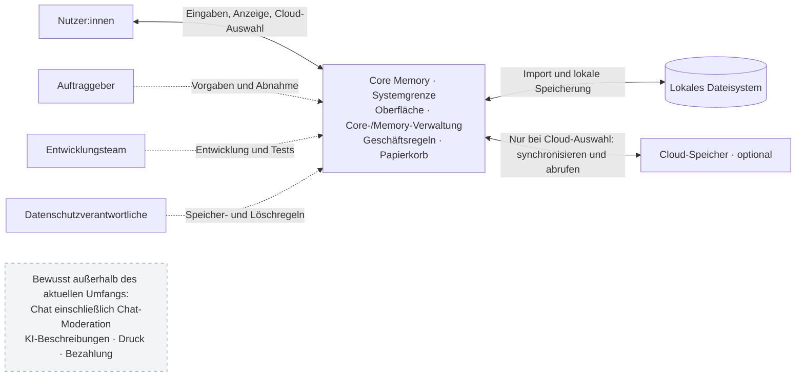
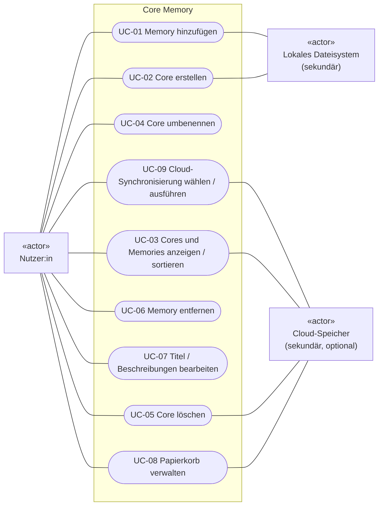

# Core Memory – REQUIREMENTS v1 (Interviewabgleich)

**Core = Album · Memory = Foto.** Stand: Block 2. Dieses Dokument beschreibt das Soll-Verhalten; der HTML-Prototyp ist kein Umsetzungsnachweis. Video-Unterstützung ist im Interview gewünscht; ihre Detailregeln sind noch offen.

## 1. Grundlage und Umfang

**Verbindliche fachliche Grundlage:** Das Interview der Auftraggebergruppe aus Block 2, Folie 31, dokumentiert im separat bereitgestellten Interviewprotokoll `Interview_merged.pdf`. Das Original ist derzeit nicht Bestandteil dieses Repositories; vor einer Veröffentlichung ist zu klären, ob es mit aufgenommen werden darf. Bei Abweichungen ersetzt es die frühere Ideensammlung. Spätere ausdrückliche Teamentscheidungen ergänzen oder ändern das Interview. Ungeklärte Aussagen werden nicht als bestätigte Grenzwerte behandelt.

**Spätere Entscheidungen:** Die Chat-Funktion entfällt nach Rückfrage aus Kapazitätsgründen, einschließlich Einzel-/Gruppenchats, Chat-Navigation, Bildnachrichten, Chat-Speicherung und Chat-Moderation. Daten werden lokal gespeichert. Nutzer:innen entscheiden, ob sie zusätzlich in die Cloud gelangen. Geräteübergreifender Zugriff setzt eine erfolgreiche Cloud-Synchronisierung voraus. Die bereits vereinbarten 30 Tage im Papierkorb, die Nichtanrechnung gelöschter Memories auf aktive Mengen-/Speicherquoten und die unveränderte Speicherung der Originaldateien bleiben ergänzende Teamvorgaben.

**Prüfungsrahmen:** Java 21, Maven-/Gradle-Wrapper, lokale Datenhaltung und die Pflichtfunktionen aus der Projektbeschreibung gelten weiter. Die technische Einordnung der Cloud- und Web-Erweiterung in diesen Rahmen ist noch abzustimmen. Die fachliche Wahl zwischen rein lokaler und zusätzlicher Cloud-Speicherung ist entschieden.

**Konkretisiert:** Cores erstellen, anzeigen, sortieren, umbenennen, beschreiben und löschen; Fotos importieren, anzeigen, beschriften, entfernen und wiederherstellen; optionale Cloud-Synchronisierung. Die bestehenden FA-01 bis FA-10 bleiben erhalten.

**Interviewwünsche mit offenen Details:** Gemeinsame Alben/Freigaben ohne Chat, Kontakte und Einladungslinks, Album-Manager mit Screenshot-Einstellung, Altersangabe und gegebenenfalls Bestätigung durch Sorgeberechtigte, Wortfilter für Titel/Beschreibungen sowie Video-Unterstützung. Diese Wünsche sind erfasst und nicht stillschweigend gestrichen; die offenen Regeln stehen in Abschnitt 8. „Modern, jugendgerecht, minimalistisch, mit eigener Gestaltung“ ist eine Gestaltungsrichtung, kein bereits messbares Akzeptanzkriterium. Die URL-Struktur bleibt der Entwicklung überlassen.

**Frühere Zusatzideen ohne neue Interviewbestätigung:** Favoriten-Cores, Kachel-/Listenansicht, Hell-/Dunkelmodus, Kameraimport und ZIP-Export bleiben im Backlog. KI-Beschreibungen, Druck, Bezahlung und die technische Umsetzung eines Abo-Verkaufs sind nicht zugesagt. Für die Prüfungsanwendung ist inzwischen ein einheitliches Cloud-Kontingent von 500 GB festgelegt; unterschiedliche Abo-Quoten entfallen.

## 2. Stakeholder und Systemgrenze

| Stakeholder | Interesse | Einfluss | Zugeordnete Anforderung |
| --- | --- | --- | --- |
| Nutzer:innen | Hoch: Fotos organisieren und wiederfinden | Mittel | Das System muss Nutzer:innen ermöglichen, Cores anzulegen und Memories zuzuordnen. |
| Auftraggeber | Hoch: überprüfbare Projektergebnisse erhalten | Hoch | Das Team muss zu den Block-Meilensteinen einen prüfbaren Stand im Repository bereitstellen. |
| Entwicklungsteam | Hoch: gemeinsam entwickeln und testen | Hoch | Das Projekt muss mit Java 21 über einen Maven- oder Gradle-Wrapper reproduzierbar gebaut werden können. |
| Datenschutzverantwortliche | Hoch: Kontrolle über gespeicherte Fotos | Mittel | Das System muss die Lösch- und Wiederherstellungsregeln GR-07/GR-08 anwenden. |

Durchgezogene Linien zeigen Schnittstellen im Betrieb, gestrichelte Linien organisatorischen Einfluss. Cloud und Dateisystem sind technische Nachbarsysteme. Offene Erweiterungen sind noch nicht als fertige Schnittstellen modelliert.

## 3. Geschäftsregeln und Entscheidungen

### Bestätigte Regeln und offene Grenzen

| ID | Regel | Quelle / Klärungsbedarf |
| --- | --- | --- |
| GR-01 | Ein **Bild darf höchstens 50 MB** groß sein. Es gilt **kein festes 10-GB-Limit je Core** mehr. Lokale Speicherung benötigt ausreichend freien Gerätespeicher. Das Cloud-Kontingent beträgt **einheitlich 500 GB je Nutzerkonto über alle Cores**; genau die Grenze ist zulässig. Nur aktive Memories werden auf die aktive Quote angerechnet. | Interview 02:08–03:30; anschließende Teamentscheidung: einheitlich 500 GB statt unterschiedlicher Tarife. Entwurfsannahme: MB = 1.000.000 Byte, GB = 1.000.000.000 Byte. Anrechnung von Metadaten/Vorschaubildern und mehrfach zugeordneten Inhalten noch offen. |
| GR-02 | Ein Core darf höchstens **10.000 aktive Fotos** enthalten. Papierkorbinhalte zählen nicht zur aktiven Anzahl. | Interview 02:08–02:19; ergänzende Teamentscheidung zum Papierkorb. Ob und wie Videos mitzählen, ist offen. |
| GR-03 | Genannte Formate sind **JPG/JPEG, HEIC, PNG, GIF, RAW einschließlich Canon CR2 sowie MP4**. Dies ist eine bestätigte Beispielliste. Originaldateien werden nicht zusätzlich komprimiert oder verändert. | Interview 05:23–06:00; Teamvorgabe zur Originalqualität. Weitere RAW-Varianten, Video-Codecs, Video-Größenlimit und Inhalts-/Endungserkennung sind offen. |
| GR-04 | Ein **Core-Name/Albumtitel ist Pflicht**, besitzt **1–50 Zeichen** nach Entfernen äußerer Leerzeichen und darf nicht nur aus Leerzeichen bestehen. Übliche Sonderzeichen und **Emojis sind erlaubt**. Ein bereits vorhandener Albumname wird automatisch durch eine angehängte „1“ unterschieden. | Interview 01:11–02:08. Genaue Zeichenmenge, Groß-/Kleinschreibung, weitere Kollisionen und ein durch den Zusatz zu langer Name sind offen. Keine bestätigte automatische Kürzung. |
| GR-05 | Die **Core-/Albumbeschreibung ist optional, höchstens 500 Zeichen** lang und erlaubt wie der Albumtitel Sonderzeichen und Emojis. **Fototitel sind Pflicht und besitzen 1–100 Zeichen.** | Interview 04:17–05:03; Pflichtstatus und 100-Zeichen-Grenze des Fototitels nachträglich vom Team bestätigt. Die maximale Länge und Zeichenregeln der optionalen Memory-Beschreibung sind noch zu klären. Albumtitel und Fototitel haben unterschiedliche Grenzen. |
| GR-06 | Inhaltsduplikate werden per **SHA-256 über die vollständigen Originaldateibytes** erkannt. Im selben Core wird ein erneuter Import mit gleichem Hash abgelehnt; dasselbe Foto ist in verschiedenen Cores erlaubt. Dateinamen entscheiden nicht über Duplikate. | Interview 05:04–05:23; zuvor bestätigte Teamentscheidung zur Ablehnung. Hinweis: „Dieses Bild existiert bereits in diesem Core und wurde nicht hinzugefügt.“ |
| GR-07 | Gelöschte Memories liegen **30 Tage** in „Zuletzt gelöscht“. Sie sind vor Ablauf wiederherstellbar, **sofern die Bedingungen aus GR-08 erfüllt sind** und sie nicht manuell endgültig gelöscht wurden. Danach werden sie automatisch endgültig gelöscht. Vor einer Core-Löschung wird eine Bestätigung verlangt; bei enthaltenen Fotos nennt der Hinweis die Auswirkungen auf diese. | Interview 06:05–06:45: Bestätigung/Papierkorb; 30 Tage und die eingeschränkte Wiederherstellungszusage sind zusätzliche Teamentscheidungen. |
| GR-08 | Wiederherstellung setzt eine noch laufende Frist, einen aktiven Ziel-Core, Platz innerhalb der aktiven Mengen-/geltenden Speichergrenzen und **kein aktives SHA-256-Duplikat** voraus. Nur aktive Memories zählen zur aktiven Quote; Papierkorbinhalte belegen dennoch physischen Speicher. Gelöschte Inhalte geben keine physische Kapazität frei. | Teamentscheidung zur Frist, Quote und Duplikatprüfung. Die Cloud-Quote begrenzt nur die anschließende Synchronisierung, nicht die lokale Wiederherstellung (GR-10/A-02). Ist der Core mengenmäßig voll, erscheint „Dieser Core ist voll. Die Memory kann nicht wiederhergestellt werden.“ Bei fehlendem Gerätespeicher wird dieser Grund genannt. Datei, Frist und Core bleiben bei Ablehnung unverändert. |
| GR-09 | Mehrfachimport ist möglich. In einen neuen leeren Core werden die ersten **10.000 zulässigen Fotos** übernommen, darüber hinaus ausgewählte Fotos nicht; ein Hinweis nennt den nicht übernommenen Teil. Erfolgreiche Importe bleiben bestehen. Es wird kein weiterer Core für den Überhang angelegt. | Interview 03:32–04:17. Reihenfolge und Verhalten bei teilweise gefüllten Cores oder einzelnen Dateifehlern siehe Entwurfsannahmen. |
| GR-10 | Daten werden **lokal** gespeichert. Cloud-Übertragung erfolgt nur nach Auswahl durch Nutzer:innen und kann auch später angestoßen werden. Nur erfolgreich synchronisierte Daten sind auf weiteren berechtigten Geräten über die Cloud abrufbar. Rein lokale Daten bleiben auf dem jeweiligen Gerät. | Aktuelle Teamentscheidung; ergänzt Interview 02:31–03:30. Die Cloud-Quote begrenzt Cloud-Übertragungen, nicht für sich allein die lokale Nutzung. |
| GR-11 | Cores und Fotos werden standardmäßig nach Datum, alternativ alphabetisch oder benutzerdefiniert per langem Drücken und Drag-and-drop sortiert. Beim Öffnen eines Cores werden zunächst **bis zu 100 Bilder** vorgeladen; weitere beim Scrollen. | Interview 07:31–09:37. Datumsart, Sortierrichtung, Nachladegröße und messbare Ladezeit sind offen. |

### Entwurfsannahmen und technische Präzisierungen

- **A-01 – Text:** NFC-Normalisierung und Zählung von Unicode-Codepoints sind technische Vorschläge; die Zeichenzählung für zusammengesetzte Emojis muss bestätigt werden. Core-Namen werden vor der Längenprüfung außen getrimmt. Für Fototitel wird dasselbe Trimmen vorgeschlagen; ein nur aus Leerzeichen bestehender Fototitel erfüllt das Pflichtfeld nicht. Die frühere enge Sonderzeichenliste und das Emoji-Verbot gelten nicht mehr. Namen mit numerischem Zusatz müssen ebenfalls die 50-Zeichen-Grenze einhalten; ungeklärte Kollisionsfälle werden nicht durch eine erfundene Regel entschieden.
- **A-02 – Einzeldateien und Synchronisierung:** Import wird je Datei lokal abgeschlossen. Bei einem lokalen Fehler wird diese Datei nicht angelegt; vorherige erfolgreiche Importe bleiben erhalten. Für teilweise gefüllte Cores wird vorgeschlagen, nur die verbleibenden Plätze zu belegen. Cloud-Synchronisierung ist ein separater Schritt: Bei fehlender Verbindung, voller Cloud-Quote oder Übertragungsfehler bleibt die lokale Datei erhalten, der Cloud-Status zeigt „nicht synchronisiert“ mit Grund. Der Synchronisierungsschritt kann erneut ausgelöst werden. Dieses Fehlerverhalten ist ein Entwurf; keine automatische Übertragung ohne Cloud-Auswahl.
- **A-03 – Löschung:** 30 Tage werden vorgeschlagen als 30 × 24 Stunden ab dauerhaft gespeichertem Löschzeitpunkt; bei rein lokaler Nutzung wird dieser lokal erfasst. Ein gelöschter Core und seine aktiven Memories liegen gemeinsam im Papierkorb. Bereits einzeln gelöschte Memories behalten ihre bisherige Frist. Core-Wiederherstellung aktiviert nur die mit ihm gelöschten, noch nicht abgelaufenen Memories, sofern alle Wiederherstellungsbedingungen erfüllt sind. Einzelne Memories eines gelöschten Cores benötigen zunächst dessen Wiederherstellung.
- **A-04 – Datenhaltung:** Die Anwendung verwaltet eigene Kopien und IDs; externe Importquellen bleiben unverändert. Endgültiges Löschen betrifft die appverwalteten Dateien, Metadaten und Vorschaubilder. Bei Cloud-Nutzung sind Löschungen auch dort nachzuführen. Backup-/Offline-Fristen, Konflikte zwischen Geräten und das Verhalten bei extern verschobenen oder fehlenden Dateien sind offen. Das Interview nennt dazu Listen mit Bildnamen/Hashes und eine aktualisierte Zuordnung (06:45–07:01), aber keinen vollständigen Ablauf.

## 4. Use Cases

### Diagramm

Cloud-Beziehungen gelten nur für gewählte bzw. bereits synchronisierte Inhalte. UC-01 speichert lokal; Cloud-Übertragung wird über UC-09 optional angeschlossen. Die organisatorischen Stakeholder stehen im Kontextdiagramm. Offene Interviewerweiterungen werden nach Klärung ihrer Regeln ergänzt.

### UC-01: Memory hinzufügen

| Feld | Beschreibung |
| --- | --- |
| Ziel / Auslöser | Ein Foto einem Core hinzufügen; Nutzer:in wählt „Memory hinzufügen“. |
| Primärer / sekundärer Akteur | Nutzer:in / lokales Dateisystem; bei anschließender Cloud-Synchronisierung zusätzlich Cloud-Speicher. |
| Vorbedingungen | Bestehender aktiver Core als Ziel ausgewählt; Nutzer:in darf ihn bearbeiten. |
| Erfolg | Jede lokal erfolgreich importierte Originaldatei ist bytegleich gespeichert und genau einmal dem Ziel-Core zugeordnet. Cloud-Verfügbarkeit wird getrennt ausgewiesen. |
| Fehler / Abbruch | Für eine lokal abgelehnte Datei entstehen keine Memory und kein dauerhaft belegter Zusatzspeicher. Vor Start abgebrochene Importe verändern den Core nicht. |

**Standardablauf:**

1. Nutzer:in öffnet im Ziel-Core den Import.
2. Das System zeigt Dateiauswahl und die Auswahl zwischen rein lokaler Speicherung und zusätzlicher Cloud-Synchronisierung.
3. Nutzer:in wählt Fotos, vergibt für jedes Foto einen Pflicht-Titel mit 1–100 Zeichen, trifft die Speicherwahl und bestätigt.
4. Das System prüft je Datei Format, Lesbarkeit, höchstens 50 MB, Pflicht-Titel nach GR-05, SHA-256-Duplikate, verfügbare Plätze und lokalen Speicher gemäß GR-01/02/03/05/06/09.
5. Das System speichert zulässige Originaldateien bytegleich lokal und ordnet sie dem Core zu; bei gewählter Cloud startet es anschließend UC-09.
6. Das System zeigt die hinzugefügten Memories, abgelehnte Dateien mit Grund und gegebenenfalls den Cloud-Status.

**A1 – Duplikat bei Schritt 4:** Diese Datei wird mit Hinweis aus GR-06 abgelehnt. Andere Dateien werden unabhängig geprüft.

**A2 – Lokales Limit, ungültiger Titel, Format oder Speicherfehler bei Schritt 4/5:** Die betroffene Datei wird mit konkretem Grund abgelehnt, ohne teilweise angelegte Memory; temporäre Daten werden verworfen. Bereits erfolgreiche Importe bleiben bestehen. Bei erreichtem Mengenlimit wird auf den nicht übernommenen Teil hingewiesen.

**A3 – Abbruch:** Vor Schritt 4 beendet das System den Import ohne Änderung. Während eines laufenden Mehrfachimports bleiben bereits abgeschlossene Dateien bestehen; noch nicht abgeschlossene werden nach A-02 abgebrochen.

**A4 – Cloud nicht verfügbar:** Nach erfolgreichem lokalen Import bleiben die Daten lokal erhalten; Cloud-Fehler werden gemäß A-02 getrennt angezeigt. Geräteübergreifender Zugriff ist erst nach erfolgreicher Synchronisierung möglich.

### UC-02: Core erstellen

| Feld | Beschreibung |
| --- | --- |
| Ziel / Auslöser | Leeren Core anlegen; Nutzer:in wählt „Core erstellen“. |
| Primärer / sekundärer Akteur | Nutzer:in / lokales Dateisystem. |
| Vorbedingung | Core-Übersicht geöffnet; lokaler Nutzerkontext bekannt. Ein Cloud-Zugang ist für rein lokale Cores nicht erforderlich. |
| Erfolg | Core mit eigener ID, gültigem Namen, optionaler Beschreibung und 0 Memories existiert lokal dauerhaft. |
| Fehler / Abbruch | Bei fehlgeschlagener Erstellung bleibt die Core-Liste unverändert. |

**Standardablauf:**

1. Nutzer:in wählt „Core erstellen“.
2. Das System zeigt Felder für den Pflichtnamen und die optionale Beschreibung.
3. Nutzer:in gibt die Daten ein und bestätigt.
4. Das System trimmt und prüft den Namen sowie die Beschreibung; bei gleichem Namen ergänzt es die „1“, sofern der resultierende Name gültig und frei ist.
5. Das System speichert den leeren Core mit eigener ID lokal.
6. Das System zeigt den Core und bestätigt seine Erstellung.

**A1 – Ungültige Eingabe:** Leerer Name nach Trimmen, mehr als 50 Zeichen oder mehr als 500 Zeichen Beschreibung: begründeter Hinweis, kein Core; Eingabe kann korrigiert werden. Andere Zeichenprüfungen setzen die noch zu bestätigende Zeichenregel voraus.

**A2 – Namenskollision:** Ist der durch „1“ ergänzte Name weiterhin belegt oder zu lang, ist das genaue Verfahren noch offen (O-02); hierfür wird kein scheinbar vollständiger Akzeptanzfall behauptet.

**A3 – Abbruch oder Speicherfehler vor erfolgreichem Abschluss:** Kein Core wird angelegt; bei Speicherfehler erscheint ein konkreter Hinweis.

**Weitere Use Cases:** UC-03 zeigt aktive Cores/Memories, sortiert nach GR-11 und lädt weitere Bilder beim Scrollen; auf weiteren Geräten zeigt es berechtigt abrufbare Cloud-Inhalte. UC-04 benennt Cores nach GR-04 um. UC-05 bestätigt und verschiebt Cores in den Papierkorb. UC-06 entfernt einzelne Memories. UC-07 bearbeitet Core-Beschreibungen sowie Memory-Titel/-Beschreibungen; deren offene Feldregeln stehen in GR-05. UC-08 führt Papierkorb-Anzeige und Zustandsübergänge nach GR-07/08 aus. UC-09 synchronisiert nach Nutzerwahl lokale Originale und die für ihre Anzeige nötigen Core-/Memory-Metadaten; dafür müssen Cloud-Zugang, Verbindung und Quote verfügbar sein. Änderungen an bereits synchronisierten Inhalten und deren Konflikt-/Löschabgleich werden unter O-03 präzisiert.

## 5. Funktionale Anforderungen

Alle zehn Anforderungen sind **MUSS-Anforderungen**. Zugehörige Geschäftsregeln sind Bestandteil der Spezifikation; ausdrücklich offene Detailregeln sind noch keine abnahmefähige Festlegung.

| ID | Use Case / Herleitung | Anforderung |
| --- | --- | --- |
| FA-01 | UC-01 Schritte 4–6 / A1, A2, A4; UC-09 | Das System muss Fotoimporte gemäß GR-01/02/03/05/06/09 lokal und bytegleich speichern oder je Datei mit Grund ablehnen; eine zusätzliche, auch nachträglich wählbare Cloud-Synchronisierung muss es gemäß GR-10 getrennt ausführen und ihren Status anzeigen. |
| FA-02 | UC-01, A3 | Wenn Nutzer:innen den Import vor Start abbrechen, muss das System den Vorgang ohne Änderung des Cores beenden. |
| FA-03 | UC-01, Vorbedingung | Das System muss den Start eines Imports verhindern, solange kein bestehender aktiver Core als Ziel ausgewählt ist. |
| FA-04 | UC-02 | Das System muss Nutzer:innen ermöglichen, einen leeren Core mit Pflichtnamen und optionaler Beschreibung gemäß GR-04/05 lokal zu erstellen. |
| FA-05 | UC-03 | Das System muss aktive Cores und ihre Memories anzeigen, nach GR-11 sortieren und Bilder beim Scrollen nachladen; auf weiteren berechtigten Geräten muss es erfolgreich synchronisierte Inhalte gemäß GR-10 zugänglich machen. |
| FA-06 | UC-04 | Das System muss Nutzer:innen ermöglichen, einen aktiven Core gemäß GR-04 umzubenennen. |
| FA-07 | UC-05 | Nach bestätigter Sicherheitsabfrage muss das System den Core samt aktiven Memories gemäß GR-07 und A-03 in den Papierkorb verschieben. Bei enthaltenen Fotos muss die Abfrage auf deren Mitlöschung hinweisen. |
| FA-08 | UC-07 | Das System muss Nutzer:innen ermöglichen, Core-Beschreibungen und Memory-Titel/-Beschreibungen gemäß den jeweils festgelegten Regeln aus GR-05 zu speichern. Fototitel sind Pflicht mit 1–100 Zeichen; die Detailregeln der Memory-Beschreibung sind vor Abnahme zu entscheiden. |
| FA-09 | UC-06 | Das System muss Nutzer:innen ermöglichen, eine aktive Memory gemäß GR-07 in den Papierkorb zu verschieben. |
| FA-10 | UC-08 | Das System muss gelöschte Inhalte auf Wunsch vor Fristablauf **nur bei erfüllten Wiederherstellungsbedingungen** gemäß GR-08/A-03 wiederherstellen, auf bestätigten Wunsch endgültig löschen und bei Fristablauf automatisch endgültig löschen. |

## 6. Nichtfunktionale Anforderungen

| ID | Merkmal / Verbindlichkeit | Bedingung und Messgröße | Herkunft / Status |
| --- | --- | --- | --- |
| NFA-01 | Performance / Zielwert offen | Für die Anzeige der ersten bis zu 100 Bilder und für das Nachladen sollen maximale Wartezeiten festgelegt werden. Testgerät, Netzbedingungen, Dateimix und Erfolgsanteil fehlen noch. Bis dahin existiert keine belastbare Zeitvorgabe. | Interview 08:17–09:37. Die früher vorgeschlagenen 2 Sekunden und 19/20 Messungen werden nicht als Interviewvorgabe fortgeführt. Das Vorladen selbst ist in FA-05/GR-11 funktional spezifiziert. |
| NFA-02 | Verständlichkeit / muss | Jede Fehlermeldung muss den konkreten Fehlergrund nennen und höchstens **50 Wörter** umfassen. Wortlaut und Sprache sind noch abzustimmen; technische Testannahme: Wörter werden durch Leerraum getrennt gezählt. | Interview 07:01–07:29. „Jugendgerecht“ bleibt eine qualitative Gestaltungsrichtung; die zuvor erfundene 8-von-10-/60-Sekunden-Vorgabe entfällt. |
| NFA-03 | Portabilität / muss | Lokales Erstellen und Importieren sowie Wiederherstellung müssen auf iOS, iPadOS, macOS, Windows, Android und Linux in der jeweils freigegebenen App-/Browser-Variante funktionieren. 100 % der drei Abnahmeszenarien müssen je freigegebener Kombination bestehen. | Interview: Cross-Plattform und Web-App (17:51–19:00); Plattformliste und iPhone 13 als Referenzgerät aus Teamvorgabe. Konkrete Varianten/Versionen sind offen; ausschließlich browserbasierte Umsetzung ist nicht beschlossen. |
| NFA-04 | Datenintegrität / muss | Erfolgreich gespeicherte, synchronisierte und wiederhergestellte Originale müssen in Dateilänge und vollständigem Bytevergleich zu 100 % mit ihrer Importquelle übereinstimmen; je freigegebenem Format lokal und bei gewählter Cloud prüfen. Vorschaubilder dürfen abweichend erzeugt werden. | Ergänzende Teamvorgabe: keine Veränderung/zusätzliche Komprimierung der Originale. |

## 7. Akzeptanzkriterien (Given / When / Then)

**Zuordnung:** AK-xx.n prüft FA-xx, AK-NFA-xx.n prüft NFA-xx. **Gemeinsame Testbasis:** Erfolgs- und Grenzfälle des Fotoimports setzen immer alle übrigen Importbedingungen voraus: aktiver berechtigter Ziel-Core, lesbarer unterstützter Inhalt, gültiger Pflicht-Titel, kein aktives Inhaltsduplikat, Einhaltung aller nicht ausdrücklich getesteten Grenzen und ausreichend lokalen Speicher. Für Core-Erstellung, Textbearbeitung und Cloud-Synchronisierung gelten jeweils deren eigene Vorbedingungen. Wiederherstellungs-Erfolgsfälle setzen zusätzlich eine laufende Frist voraus. Ein isolierter Grenzwert hebt keinen anderen Ablehnungsgrund auf. Bei mehreren Fehlergründen wird kein Erfolg erwartet; eine Meldungspriorität ist noch nicht festgelegt.

**Noch bedingte Tests:** Q bezeichnet die bestätigte albumübergreifende Cloud-Quote von 500 GB je Nutzerkonto. 50 MB = 50.000.000 Byte und 500 GB = 500.000.000.000 Byte sind technische Testannahmen. Die anrechenbare Cloud-Belegung wird für Quotentests kontrolliert vorgegeben; genaue Belegungsberechnung sowie vollständige Format-/Zeichenmatrizen müssen vor Abnahme bestätigt werden. Grenztests mit kontrollierten Metadaten ersetzen keine integrierten Speicherprüfungen.

| ID | Given | When | Then |
| --- | --- | --- | --- |
| AK-01.1 | Aktiver Core, gültiges Foto, Cloud nicht ausgewählt; alle Importbedingungen erfüllt | Foto wird importiert | Eine Memory ist bytegleich lokal gespeichert; keine Übertragung an die Cloud. |
| AK-01.2 | Je eine gültige Testdatei der freigegebenen JPG/JPEG/HEIC/PNG/GIF/RAW-Varianten einschließlich CR2; alle Importbedingungen erfüllt | Dateien werden importiert | Jede wird im Original übernommen. Video-Tests folgen nach Klärung der MP4-Regeln. |
| AK-01.3 | Gleiche Dateibytes bereits aktiv im Ziel-Core, neuer Dateiname | Kopie wird importiert | Duplikathinweis, keine zusätzliche Memory und keine zusätzliche aktive Belegung. |
| AK-01.4 | Identischer Inhalt nur in Core A, Ziel ist Core B; alle übrigen Importbedingungen erfüllt | Datei wird in B importiert | Import gelingt; A bleibt unverändert. |
| AK-01.5 | 9.999 aktive Fotos; kein Duplikat und alle übrigen Importbedingungen erfüllt | Ein zulässiges Foto wird importiert | Genau 10.000 aktive Fotos; Import gelingt. |
| AK-01.6 | 10.000 aktive Fotos; alle übrigen Importbedingungen erfüllt | Weiteres Foto wird importiert | Mengenlimit wird genannt; kein weiterer Import. |
| AK-01.7 | Foto mit genau 50 MB; kein Duplikat und alle übrigen Importbedingungen erfüllt | Foto wird importiert | Import gelingt. |
| AK-01.8 | Foto mit 50 MB plus einem Byte; alle übrigen Importbedingungen erfüllt | Import wird versucht | Dateigrößenlimit wird genannt; kein Import. |
| AK-01.9 | Leerer Core; 10.001 unterschiedliche zulässige Fotos, ausreichend lokaler Speicher, Cloud aus | Mehrfachimport wird bestätigt | Erste 10.000 werden übernommen; weiteres Foto nicht; Hinweis auf nicht übernommenen Teil. Testreihenfolge vor Ausführung festlegen. |
| AK-01.10 | Nicht unterstützter Inhalt oder unlesbare Datei | Import wird versucht | Konkreter Grund; keine Memory und kein dauerhaft belegter Zusatzspeicher. Validierungsmatrix vor Abnahme festlegen. |
| AK-01.11 | Zulässiges Foto; lokales Speichern schlägt fehl | Import wird versucht | Lokaler Speicherfehler; keine teilweise angelegte Memory, temporäre Daten verworfen. |
| AK-01.12 | Zulässiges Foto; Cloud gewählt, Zugang/Netz/Quote verfügbar; alle Importbedingungen erfüllt | Import und Synchronisierung werden abgeschlossen | Original lokal und in Cloud bytegleich; Status „synchronisiert“. |
| AK-01.13 | Gleicher Dateiname im Core, aber anderer Inhalt und SHA-256; alle übrigen Importbedingungen erfüllt | Datei wird importiert | Beide Inhalte bleiben getrennt erhalten. |
| AK-01.14 | Foto erfolgreich lokal importiert; Cloud gewählt, aber Übertragung scheitert | Cloud-Synchronisierung endet mit Fehler | Lokale Memory bleibt erhalten; Cloud-Status „nicht synchronisiert“ mit Grund; erneut auslösbar (Entwurf A-02). |
| AK-01.15 | Bisher rein lokale Memory; Cloud-Zugang/Netz/Quote verfügbar | Nutzer:in aktiviert Cloud-Synchronisierung für diese Daten | Datei und benötigte Metadaten werden synchronisiert; erst danach auf weiterem berechtigten Gerät abrufbar. |
| AK-01.16 | Cloud-Quote Q = 500 GB; Cloud-Belegung plus Übertragung ergibt genau Q; alle übrigen Synchronisierungsbedingungen erfüllt | Cloud-Synchronisierung wird ausgeführt | Übertragung gelingt; Belegung Q. |
| AK-01.17 | Cloud-Quote Q = 500 GB; Belegung plus Übertragung wäre Q + 1 Byte; alle übrigen Synchronisierungsbedingungen erfüllt | Cloud-Synchronisierung wird versucht | Quotenhinweis; kein zusätzlicher Cloud-Inhalt; lokale Datei bleibt erhalten. |
| AK-01.18 | Kein Cloud-Zugang oder kein Netz; Cloud nicht ausgewählt; alle lokalen Importbedingungen erfüllt | Foto wird importiert | Lokaler Import gelingt ohne Cloud-Zugang oder Verbindung. |
| AK-01.19 | Zulässiges Foto, aber Pflicht-Titel leer, nur Leerzeichen oder länger als 100 Zeichen | Import wird bestätigt | Hinweis auf ungültigen Fototitel; diese Datei wird weder importiert noch synchronisiert. |
| AK-02.1 | Dateien ausgewählt, Import noch nicht gestartet | Nutzer:in schließt den Dialog | Core-Inhalt, Anzahl und Speicherbelegung bleiben unverändert. |
| AK-03.1 | Kein Ziel-Core ausgewählt oder Ziel-Core gelöscht | Import wird ausgelöst | Kein Import startet; aktiver Ziel-Core wird angefordert. |
| AK-04.1 | Freier gültiger Name mit genau 50 Zeichen; Beschreibung leer; Speicher verfügbar | Core wird erstellt | Neuer leerer Core wird lokal angelegt; Cloud ist nicht erforderlich. |
| AK-04.2 | Name nach Entfernen äußerer Leerzeichen leer oder 51 Zeichen lang | Erstellung wird bestätigt | Begründeter Hinweis; kein Core. |
| AK-04.3 | Gültige Daten; lokales Speichern schlägt fehl | Erstellung wird bestätigt | Fehlermeldung; bisherige Core-Liste bleibt unverändert. |
| AK-04.4 | Name „  Urlaub  “ eingegeben; „Urlaub“ noch frei | Core wird erstellt | Name lautet „Urlaub“. |
| AK-04.5 | „Urlaub“ vorhanden; „Urlaub1“ frei; übrige Bedingungen erfüllt | Ein weiterer Core namens „Urlaub“ wird erstellt | Neuer Core heißt „Urlaub1“; bestehender Core bleibt erhalten. |
| AK-04.6 | Freier Name „Urlaub ☀“, unter der Grenze; übrige Bedingungen erfüllt | Core wird erstellt | Name einschließlich Emoji wird angenommen. |
| AK-05.1 | Core enthält zwei aktive und eine gelöschte Memory | Core wird geöffnet | Zwei aktive Memories sind sichtbar; gelöschte nur im Papierkorb. |
| AK-05.2 | Aktiver Core ohne Memories | Core wird geöffnet | Leerer Zustand und Anzahl 0, kein Fehler. |
| AK-05.3 | Core mit 150 aktiven Fotos; Standardsortierung | Core wird geöffnet | Zunächst die ersten 100 Bilder gemäß Datumssortierung geladen; Datumsart/Richtung vor Abnahme festlegen. |
| AK-05.4 | Erste 100 von 150 Fotos geladen | Nutzer:in scrollt über den geladenen Bereich hinaus | Weitere Bilder werden nachgeladen und erreichbar; konkrete Blockgröße noch offen. |
| AK-05.5 | Cores/Fotos mit unterschiedlichen Namen; Sortierkonvention festgelegt | Nutzer:in wählt alphabetische Sortierung | Anzeige folgt dieser alphabetischen Reihenfolge. |
| AK-05.6 | Benutzerdefinierte Sortierung ausgewählt | Nutzer:in verschiebt ein Element per langem Drücken und Drag-and-drop | Angezeigte Reihenfolge folgt der gewählten Position. |
| AK-05.7 | Gerät A enthält rein lokale und erfolgreich synchronisierte Inhalte; berechtigter Cloud-Zugang auf Gerät B | Nutzer:in öffnet die Übersicht auf B | Synchronisierte Inhalte sind abrufbar; nur auf A vorhandene lokale Inhalte nicht. |
| AK-06.1 | Aktiver Core, freier gültiger neuer Name | Umbenennung wird bestätigt | Name geändert; Core-ID und Memories unverändert. |
| AK-06.2 | Neuer Name nach Trimmen leer oder länger als 50 Zeichen | Umbenennung wird bestätigt | Fehlermeldung; bisheriger Name bleibt erhalten. |
| AK-06.3 | Neuer Name bereits belegt; durch „1“ ergänzter Name frei und gültig | Umbenennung wird bestätigt | Ergänzter Name wird verwendet; andere Cores bleiben unverändert. Anwendung der Kollisionsregel auch beim Umbenennen ist Entwurf. |
| AK-07.1 | Core mit aktiven Memories | Nutzer:in fordert Core-Löschung an | Sicherheitsabfrage weist auf enthaltene Fotos und deren Verschieben in den Papierkorb hin; noch keine Löschung. |
| AK-07.2 | Sicherheitsabfrage geöffnet | Nutzer:in bestätigt Core-Löschung | Core und aktive Memories im Papierkorb; bisherige Frist bereits gelöschter Memories unverändert. |
| AK-07.3 | Sicherheitsabfrage geöffnet | Nutzer:in bricht ab | Core und Memories bleiben unverändert aktiv. |
| AK-08.1 | Core-Beschreibung mit genau 500 zulässigen Zeichen; übrige Bedingungen erfüllt | Beschreibung wird gespeichert | Vollständig abrufbar; Originaldateien unverändert. |
| AK-08.2 | Core-Beschreibung mit 501 Zeichen | Speicherung wird bestätigt | Hinweis; bisherige Beschreibung bleibt erhalten. |
| AK-08.3 | Aktive Memory; Fototitel mit genau 100 zulässigen Zeichen, übrige Bedingungen erfüllt | Titel wird gespeichert | Titel vollständig abrufbar; Originaldatei unverändert. |
| AK-08.4 | Core besitzt eine Beschreibung | Nutzer:in speichert eine leere Beschreibung | Beschreibung ist leer; Vorgang gelingt, da optional. |
| AK-08.5 | Aktive Memory; neuer Titel leer, nur Leerzeichen oder nach der Textprüfung 101 Zeichen lang | Titeländerung wird bestätigt | Hinweis; bisheriger gültiger Titel bleibt erhalten. |
| AK-08.6 | Aktive Memory; neuer Titel mit genau einem zulässigen Nicht-Leerzeichen | Titeländerung wird bestätigt | Titel wird gespeichert; Mindestlänge erfüllt. |
| AK-08.7 | Aktive Memory; Beschreibung entspricht der noch festzulegenden Feldregel | Beschreibung wird gespeichert | Beschreibung abrufbar; Originaldatei unverändert. Dieses Kriterium ist bis zur Festlegung der Feldregel bedingt. |
| AK-09.1 | Aktive Memory im Core | Nutzer:in entfernt die Memory | Mit Löschzeitpunkt im Papierkorb; nicht aktiv; externe Importquelle unverändert. |
| AK-09.2 | Core an der Mengengrenze | Eine Memory wird entfernt | Aktive Anzahl sinkt um 1; Datei belegt im Papierkorb weiterhin physischen Speicher. |
| AK-10.1 | Frist läuft noch; aktiver Ziel-Core; kein aktives Duplikat, alle Mengen-/Speicherbedingungen erfüllt | Wiederherstellung wird bestätigt | Memory mit Daten/Metadaten aktiv; aktive Anzahl und Belegung steigen entsprechend. |
| AK-10.2 | Memory im Papierkorb | Nutzer:in bestätigt endgültige Löschung | Appverwaltete Daten werden endgültig entfernt; keine Wiederherstellung. Offline-/Cloud-Löschfristen noch zu konkretisieren. |
| AK-10.3 | Löschfrist erreicht | Fristablauf wird verarbeitet | Endgültige Löschung wird ausgeführt; Wiederherstellung ab Fristende abgelehnt. Maximale Verarbeitungsverzögerung noch offen. |
| AK-10.4 | Core gelöscht, Frist läuft; alle Wiederherstellungsbedingungen erfüllt | Core wird wiederhergestellt | Core und mit ihm gelöschte, noch gültige Memories aktiv; früher einzeln gelöschte bleiben im Papierkorb. |
| AK-10.5 | Frist läuft, kein Duplikat, Ziel-Core bereits mit 10.000 aktiven Fotos | Wiederherstellung einer Memory wird versucht | Voll-Hinweis; Memory, ursprüngliche Frist und Core bleiben unverändert. |
| AK-10.6 | Frist läuft; aktiver Ziel-Core; **kein aktives Inhaltsduplikat**; Wiederherstellung ergibt genau 10.000 Fotos und alle übrigen Speicher-/Wiederherstellungsbedingungen sind erfüllt | Wiederherstellung wird bestätigt | Wiederherstellung gelingt. |
| AK-10.7 | Frist läuft; gleiche SHA-256 bereits aktiv im Ziel-Core, auch wenn die Wiederherstellung genau eine Mengengrenze erreichen würde | Wiederherstellung wird versucht | Duplikathinweis; Memory bleibt mit unveränderter Frist im Papierkorb. |
| AK-10.8 | Frist abgelaufen; Datei noch nicht physisch bereinigt | Wiederherstellung wird versucht | Ablehnung wegen Fristablauf, keine aktive Memory. |
| AK-10.9 | Frist läuft, Ziel-Core aktiv, kein Duplikat, alle lokalen Wiederherstellungsbedingungen erfüllt; Cloud gewählt, aber 500-GB-Quote würde überschritten | Memory wird wiederhergestellt und Synchronisierung versucht | Lokale Wiederherstellung gelingt; keine zusätzliche Cloud-Belegung, Status „nicht synchronisiert“ mit Quotenhinweis (Entwurf A-02). |
| AK-NFA-02.1 | Ein spezifizierter Fehlerfall wird ausgelöst | System zeigt die Fehlermeldung | Konkreter Grund genannt, höchstens 50 Wörter nach vereinbarter Zählweise. |
| AK-NFA-03.1 | App-/OS-/Browser-Matrix freigegeben | Lokaler Import, Core-Erstellung und Wiederherstellung werden auf jeder Kombination geprüft | Alle drei Szenarien bestehen; Gerät und Versionen sind protokolliert. |
| AK-NFA-04.1 | Testoriginale aller freigegebenen Formate; alle Import-/Wiederherstellungsbedingungen erfüllt | Lokal speichern, optional synchronisieren, entfernen und wiederherstellen | Alle erfolgreich gespeicherten Originalkopien stimmen in Dateilänge und Bytes mit den Testoriginalen überein. |

**NFA-01 besitzt noch kein ausführbares Akzeptanzkriterium:** Wartezeit, Messbedingungen und Erfolgsanteil fehlen im Interview. Diese Werte werden nicht erfunden. Alle funktionalen MUSS-Anforderungen und NFA-02 bis NFA-04 haben zugeordnete Kriterien; bedingte Kriterien sind ausdrücklich markiert.

## 8. Offene Entscheidungen und Review

Drei gebündelte Klärungspunkte; darin bleiben die einzelnen Fragen sichtbar:

1. **O-01 – Speicher, Plattform und Qualität:** Genaue Byte-Einheiten, Zählung von Metadaten/Vorschaubildern und mehrfach zugeordneten Inhalten beim bestätigten 500-GB-Kontingent, freigegebene Plattformvarianten, Einordnung in den Java-Prüfungsrahmen sowie Ladezeit und Messaufbau. Lokale Speicherung und freiwillige Cloud sind bereits entschieden. Die Quote beträgt einheitlich 500 GB; das lokale Gerät wird nur durch seinen verfügbaren Speicher begrenzt.
2. **O-02 – Eingaben, Medien und Anzeige:** Maximallänge und Zeichenregeln der optionalen Memory-Beschreibung; genaue Sonderzeichen-/Emoji-Regeln und Zählweise; Namenssuffix bei weiteren Kollisionen/Maximallänge; Format-/Codec-Liste, Videogröße und Anrechnung von Videos; Sortierdatum/-richtung und Nachladegröße. Der im Interview gewünschte Wortfilter benötigt eine konkrete Liste und ein festgelegtes Fehlerverhalten. Bestätigt sind 500 Zeichen für die optionale Albumbeschreibung und 1–100 Zeichen für den Pflicht-Fototitel. Videogrenzen bleiben auf ausdrücklichen Wunsch offen.
3. **O-03 – Erweiterungen, Datenhaltung und Rechte:** Freigaben ohne Chat einschließlich Lese-/Schreib-/Löschrechten; Kontakteinladungen über Gerät bzw. Link im Web; erstellende Person als Album-Manager und gewünschte Screenshot-Einstellung; Altersangabe/Bestätigung durch Sorgeberechtigte ohne bisher festgelegte Altersgrenze. Dazu Cloud-Auswahlgranularität, Verhalten beim Abschalten, Änderungen/Konflikte zwischen Geräten, Fehlverhalten aus A-02, Core-Wiederherstellung sowie Löschfristen für Offline-Kopien/Backups und fehlende/verschobene Originaldateien. Chat-Moderation und sonstige Chat-Regeln entfallen.

**Review-Status:** Interview zur Anforderungserhebung durchgeführt und eingearbeitet. Ein Partnerteam-Review-Issue wurde bisher nicht nachgewiesen; Interview und Review sind unterschiedliche Schritte. Nach Eingang werden Entscheidungen, Maßnahmen, Verantwortliche und Zieltermine dokumentiert.

**Checkpoint:** 10 funktionale Anforderungen mit zugeordneten Kriterien und zwei vollständig strukturierten Hauptabläufen sind vorhanden. Offene Sonderfälle und Erweiterungen verhindern eine vollständige Abnahme. Drei NFA besitzen Messgrößen (teils noch offene Testmatrix); die Performance-NFA ist unvollständig. Die Vorlesung fordert Issues mit Verantwortlichen für offene/teilweise erledigte Punkte; diese sind noch zuzuordnen.

## 9. Quellen

- Interviewprotokoll mit Zeitangaben (`Interview_merged.pdf`, separat bereitgestellt und derzeit nicht im Repository); Grundlage: Interviewaufnahme und Mitschrift „Geschäftsregeln und Acceptance Criteria.pdf“. Bei Konflikten ist die eindeutig zuordenbare Interviewaussage maßgeblich; ungeklärte Angaben bleiben offen.
- Nachträgliche Teamentscheidungen: Chat entfällt; lokale Speicherung mit freiwilliger Cloud für geräteübergreifenden Zugriff; Annahme der Korrekturen zu Wiederherstellung und Grenzfällen; einheitlich 500 GB Cloud-Speicher; Fototitel Pflicht mit maximal 100 Zeichen; Videogrenzen bleiben offen. Frühere, weiterhin passende Teamvorgaben: 30 Tage Papierkorb, nur aktive Memories zählen, Originalqualität, Plattformliste und iPhone 13.
- Block 2: Geschäftsregeln/Interview und Akzeptanzkriterien (Folie 31), Requirement Clinic und Review (Folien 32–33), Checkpoint (Folie 43). Beispielzahlen der Vorlesung ersetzen keine Auftraggeberentscheidung.
- Block 1 und Projektbeschreibung Photo Album v3: Vorgehen und technischer Prüfungsrahmen.
- Prototyp: Als Quelle sind Branch `prototyp/core-memory-app`, Commit `3f816dc` und `prototypes/core-memory-app-prototyp.html` angegeben; der HTML-Prototyp liegt in diesem Checkout nicht vor. Ältere Screenshots sind nur visuelle Referenzen: Chat gehört nicht zum aktuellen Umfang, und die dort gezeigte 5-GB-Anzeige ist durch das bestätigte Cloud-Kontingent von 500 GB ersetzt.
